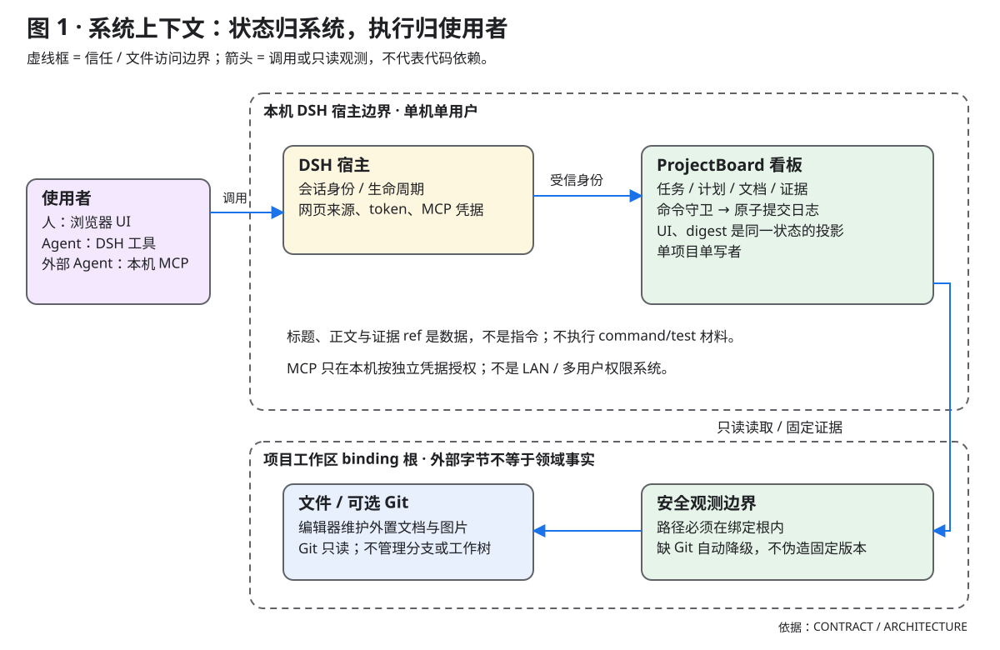
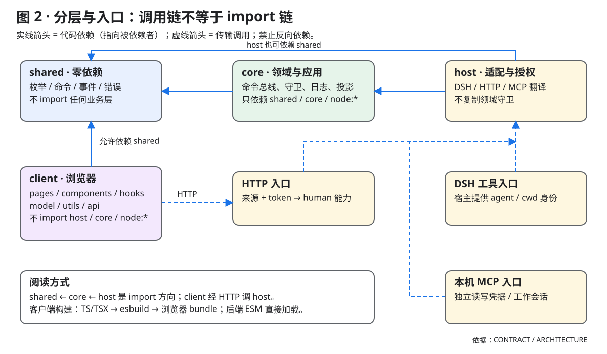
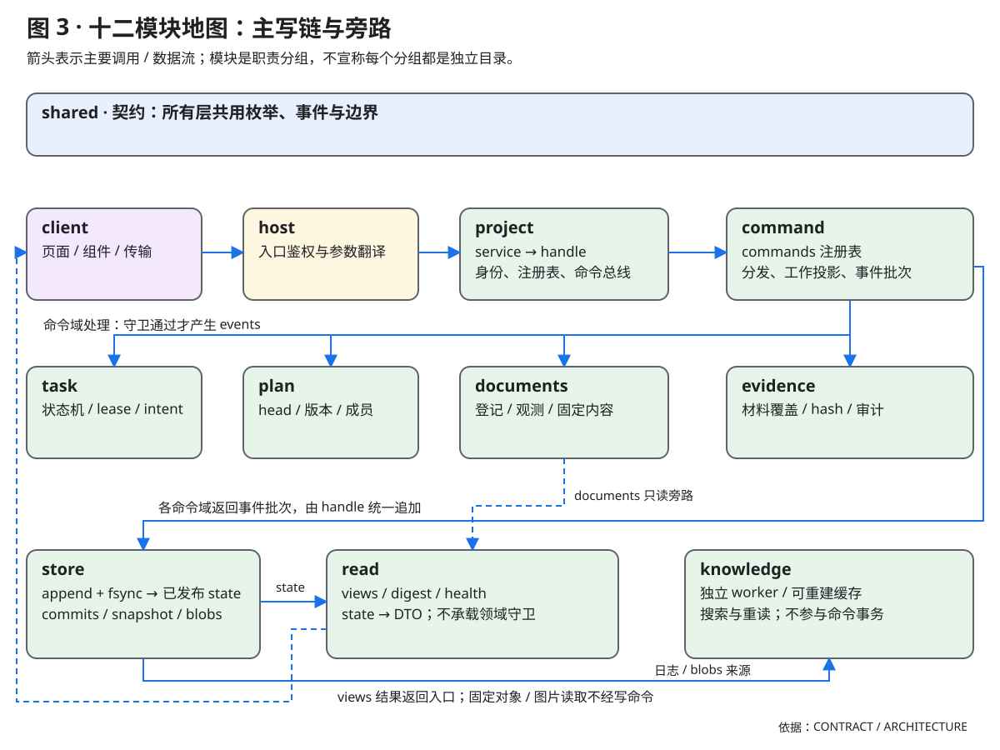
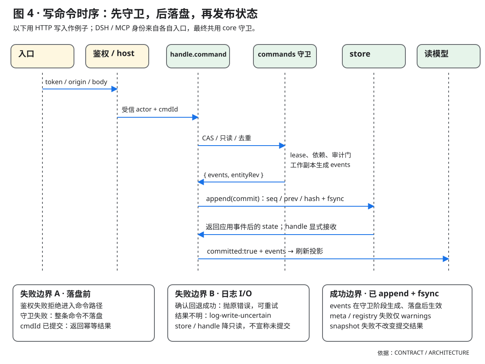
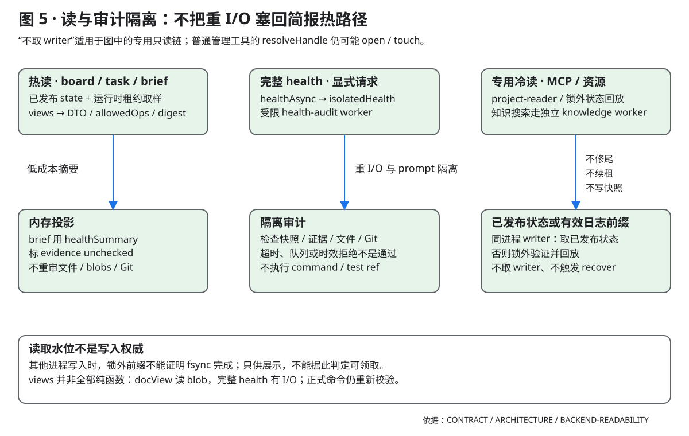
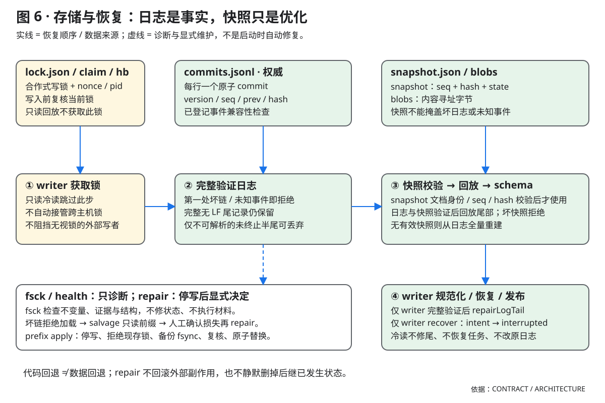

# 架构与模块地图

> 本文描述当前实现：代码分几层、每层放什么、改一个东西该动哪里。
> §2.1 的模块清单是**机器校验**的：`npm run check:architecture` 逐行核对磁盘。

产品与支持矩阵见 [README](<../README.md>)，贡献入口见 [CONTRIBUTING](<CONTRIBUTING.md>)，安装见 [INSTALL](<INSTALL.md>)，数据恢复与升级见 [RECOVERY](<RECOVERY.md>) / [MIGRATION](<MIGRATION.md>)。产品包含 UI、DSH agent 工具和可选本机 MCP，单机单用户、每项目单写者；Git只读且可选，不提供分支/worktree隔离、集成或复验。外置文件由编辑器维护，登记/基线/管理状态独立；内嵌正文仅作只读档案。

---

## 0. 系统上下文



- 使用者通过 UI、DSH 工具或本机 MCP 操作同一个持久状态机。
- DSH 提供身份与入口能力；ProjectBoard 的 core 负责领域守卫和提交。
- 工作区文件与 Git 是只读观测来源，正文、标题与证据材料不是指令。
- Git 可选且不负责分支或 worktree 管理；看板不执行 command/test 证据。

## 1. 分层与依赖方向



- 实线指向被 import 的层；shared 零依赖，core 不依赖 host 或 client。
- client 与 host 之间是 HTTP 传输，不是 client import host；client 允许依赖 shared。
- DSH、HTTP、MCP 分别建立身份，最终复用 core 的业务守卫。
- 浏览器源码经开发期构建交付；后端 ESM 直接加载，不在运行时构建。

```
┌──────────────────────────────────────────────────────────────┐
│ src/client            浏览器半（全量 TS/TSX，classic JSX）      │
│   index.ts 注册；pages 编排；components 投影；api 唯一 fetch │
└────────────────────────────┬─────────────────────────────────┘
                             │ HTTP /project-board/api（token + JSON）
┌────────────────────────────▼─────────────────────────────────┐
│ lib/host              DSH 适配层（入口在 lib/index.js，不在 host/ 下） │
│   tools/*（7 个工具） routes/*（REST） lifecycle prompt auth util│
│   只做翻译：参数 → 命令，错误 → HTTP；不做领域判断               │
└────────────────────────────┬─────────────────────────────────┘
                             │ command(op, actor, expected) / query(view)
┌────────────────────────────▼─────────────────────────────────┐
│ lib/core              应用层 + 领域层                          │
│   service（项目注册表）/ handle（命令总线）/ commands/*（每域） │
│   lease / model / normalize / contracts / store / views        │
│   digest / fsck / repair / evidence                            │
└────────────────────────────┬─────────────────────────────────┘
                             │ 纯数据（枚举、命令名、模板）
┌────────────────────────────▼─────────────────────────────────┐
│ lib/shared            契约（零依赖、无副作用）                  │
│   TASK_STATES / COMMAND_OPS / EVIDENCE_KINDS / DOC_KINDS       │
│   ERROR_STATUS / API_PATHS / TOOL_NAMES                        │
└──────────────────────────────────────────────────────────────┘
```

**硬规则**（`scripts/maintainability-audit.mjs` 检查）：

| 层 | 允许 import | 禁止 |
|---|---|---|
| `lib/shared` | 无 | 任何东西 |
| `lib/core` | `lib/shared`、core 内部、`node:*` | `lib/host`、`src/client`、DSH 包 |
| `lib/host` | `lib/core`、`lib/shared`、DSH 包、`node:*` | `src/client` |
| `src/client` | `react`、`lib/shared`、client 内部 | `node:*`、`lib/core`、`lib/host` |

依赖图零环。领域规则不放在 host，也不放在 views：views 只把 state 投影成 DTO，
`task.claim` 的资格判定在 `lib/core/lease.js`，`allowedOps()` 负责投影判定结果。

> 现状备注：`src/client/**` 目前没有直接 import `lib/shared`（命令/端点白名单由
> `test/client/client-smoke.mjs` 直接读共享契约来冻结），但依赖方向允许，不要反向依赖。

### 1.1 客户端内部分层（`npm run check:client-layers`）

`src/client` 的内部布局是 `pages / components / hooks / model / utils / api`；`scripts/check-client-layers.mjs` 用 `tools/typescript` 的隔离 parser 读 AST（先 `npm --prefix tools/typescript ci --ignore-scripts`，CI 已装），按跨层方向与同层无环校验：

| 层 | 允许跨层 import |
|---|---|
| `pages` | components / hooks / model / utils / api |
| `components` | components / model / utils |
| `hooks` | api / model / utils |
| `model` | model / utils |
| `utils` | utils |
| `api` | api / model / utils |

- 各层允许同层 import，但全图必须 0 环；`components` 不依赖 `hooks`，`model/utils/api` 不 import React。
- `fetch` 只允许 `src/client/api/transport.*`（迁移期也允许根 `transport.js`）；禁止 `node:*`、`lib/core`、`lib/host`。
- 文件 ≤450 行；组件 ≤200 行仍由 `maintainability-audit.mjs` 负责。
- 迁移期（S3）：根目录与 `views/` 的旧文件是 legacy，跳过跨层矩阵但保留全局规则；`--strict` 把非保留 legacy 文件判失败。保留白名单：`index.ts`、`styles.ts` 与无运行时代码的 `react.d.ts` / `css.d.ts`。
- 退出条件：S3 收口后把 `audit:check` 与 CI 的命令改为 `check:client-layers --strict`，此后不得新增 legacy 文件。设计基线见 [前端分层与迁移基线](design/frontend-layering.md)。

---

## 2. 模块清单



- 十二个框按职责分组；精确文件集合仍以下面的 arch-map 为准。
- 主写链是 host → service → handle → commands → store，命令域先守卫后生成事件。
- read 将已发布状态投影为 DTO；views 不复制领域守卫，documents 有只读旁路。
- knowledge 使用独立 worker 和可重建缓存，不参与命令事务、恢复或验收。

### 2.1 机器可校验的清单（arch-map）

下面这个块是**唯一**的模块清单事实源：每行一个仓库相对路径，可以含段内 `*` 通配。
`scripts/check-architecture.mjs` 逐项检查存在性；`test/ops/architecture-map.test.mjs` 断言零缺失；
`npm run check:architecture` 在本地/评审门禁里跑同一逻辑。新增/删除/改名模块时必须同步这一块。

<!-- arch-map:start -->
lib/index.js
lib/client.js
lib/shared/contract.js
lib/shared/events.js
lib/shared/knowledge.js
lib/shared/fixed-schema.js
lib/shared/verification.js
lib/shared/verification.d.ts
lib/core/service.js
lib/core/project-reader.js
lib/core/project-reader-worker.js
lib/core/project-reader-views.js
lib/core/project-reader-projection.js
lib/core/project-read-handle.js
lib/core/knowledge/*.js
lib/core/handle.js
lib/core/lease.js
lib/core/normalize.js
lib/core/plan-stages.js
lib/core/contracts.js
lib/core/evidence.js
lib/core/audit.js
lib/core/schema.js
lib/core/command-shape.js
lib/core/inline-doc-access.js
lib/core/intent.js
lib/core/model.js
lib/core/store.js
lib/core/store/lock.js
lib/core/store/format.js
lib/core/store/files.js
lib/core/store/writes.js
lib/core/commands/index.js
lib/core/commands/task.js
lib/core/commands/task-intake.js
lib/core/commands/task-work.js
lib/core/commands/task-gov.js
lib/core/commands/plan.js
lib/core/commands/plan-life.js
lib/core/commands/plan-members.js
lib/core/commands/project.js
lib/core/commands/doc.js
lib/core/commands/doc-external.js
lib/core/commands/session.js
lib/core/views.js
lib/core/digest.js
lib/core/fsck.js
lib/core/repair.js
lib/core/errors.js
lib/core/util.js
lib/core/git-exec.js
lib/core/documents/locate.js
lib/core/documents/read.js
lib/core/documents/assets.js
lib/core/documents/external-model.js
lib/core/documents/external-observe.js
lib/core/documents/external-git.js
lib/core/documents/fixed-git.js
lib/core/documents/fixed-worktree.js
lib/core/documents/fixed-reference.js
lib/core/documents/fixed-content.js
lib/core/documents/fixed-auto.js
lib/core/identity/registry.js
lib/core/identity/bindings.js
lib/core/identity/discover.js
lib/core/identity/ops.js
lib/host/routes.js
lib/host/routes/*.js
lib/host/tools.js
lib/host/tools/*.js
lib/host/lifecycle.js
lib/host/prompt.js
lib/host/auth.js
lib/host/mcp.js
lib/host/mcp-http.js
lib/host/mcp-tools.js
lib/host/mcp-write.js
lib/host/mcp-knowledge.js
lib/host/util.js
src/client/index.ts
src/client/styles.css
src/client/styles.ts
src/client/react.d.ts
src/client/css.d.ts
src/client/pages/*.tsx
src/client/components/*.tsx
src/client/hooks/*.ts
src/client/model/*.ts
src/client/utils/*.ts
src/client/api/*.ts
src/client/api/request-gate.ts
src/client/api/read-lifecycle.ts
<!-- arch-map:end -->

### 2.2 职责分组

| 层 / 目录 | 放什么 | 关键文件 |
|---|---|---|
| `lib/index.js` | cordis 插件入口：`name` / `inject` / `apply`，装配 tools + routes + lifecycle | `lib/index.js` |
| `lib/shared` | 状态机枚举、命令 op、证据类型、文档类型、错误码、API 模板、工具名、事件兼容分类 | `lib/shared/contract.js` `lib/shared/events.js` |
| `lib/core` | 项目注册表、命令总线、租约、状态机、存储、读模型、简报、fsck、修复 | `service.js` `handle.js` `lease.js` `model.js` `store.js` |
| `lib/core/commands` | 每个域一个模块；`index.js` 是 op → handler 注册表 | `task-intake.js` `task-work.js` `task-gov.js` `plan-life.js` `plan-members.js` `project.js` `doc.js` `session.js` |
| `lib/core/store` | 日志格式与哈希、跨进程文件锁、局部写适配/append 恢复、快照/blob 侧文件 | `format.js` `lock.js` `writes.js` `files.js` |
| `lib/host` | 工具、REST 路由、生命周期、提示词、鉴权、HTTP 工具 | `tools/*` `routes/*` `lifecycle.js` `prompt.js` `auth.js` `util.js` |
| `src/client` | 浏览器入口、slot 注册与样式注入 | `index.ts` `styles.ts` |
| `src/client/pages` | 页面/编辑器容器，取数、写入与页面编排 | `board-page.tsx` `docs.tsx` `task-drawer.tsx` `external-forms.tsx` `doc-list.tsx` |
| `src/client/components` | props 驱动的展示、基础控件、Drawer、slot 投影；不 import hooks/api | `board.tsx` `drawer.tsx` `primitives.tsx` |
| `src/client/hooks` | React 页面读写适配、独立 health 调度、导航 context 与 toast | `use-page-read.js` `page-navigation.ts` `use-health.ts` `use-toasts.ts` `use-external-docs.ts` |
| `src/client/model` | 纯读模型、payload、导航与轮询策略常量；不 import React | `races.ts` `project-location.ts` |
| `src/client/utils` | 解析、格式化、布局等纯工具 | `format.ts` `markdown.ts` |
| `src/client/api` | 唯一 fetch、请求票据/取消与资源读生命周期；不 import React | `transport.ts` `request-gate.ts` `read-lifecycle.ts` |
| `scripts/` | 仓库开发期安装、构建、预览、修复、迁移核对、审计、架构校验；不是用户 CLI，npm 包不含此目录 | `build-client.mjs` `install.mjs` `guards.mjs` `migrate-plans.mjs` `maintainability-audit.mjs` `check-architecture.mjs` |
| `test/` | core / client / host 三组测试与 fixture | `test/**/*.test.mjs` `test/client/unit/*` |
| `tools/build` | 仅开发期的客户端构建工具链（自己的 package.json + lockfile） | `tools/build/package.json` |
| `tools/typescript` | 隔离的开发期 TypeScript/Node 声明；无运行时 emit | `tools/typescript/package.json` |

`lib/core/commands/index.js` 的键顺序与 `lib/shared/contract.js` 的 `COMMAND_OPS` 一致，
并由 `test/contract/contract-parity.test.mjs` 断言：新增 op 不同步共享契约就分发不出去。

`lib/host/tools.js` 是兼容壳（保留旧解析路径），真正的实现在 `lib/host/tools/*.js`；
DSH 运行时通过 `lib/index.js` → `lib/host/tools/index.js` 注册。路由同理：
`lib/host/routes.js` 负责前缀、鉴权和分发，资源实现在 `lib/host/routes/*.js`。

---

## 3. 一条命令的完整路径



- 图以 HTTP 为例；鉴权先于命令分发，业务身份不能由请求正文自授。
- handle 在工作副本上分发命令，守卫通过后才向 store 提交事件批次。
- append + fsync 才能返回 committed:true；handle 显式接收 store 返回的 state。
- 日志 I/O 结果不明时降只读，不能声称确定未提交；相同 cmdId 用于幂等。
- meta/registry 警告与快照优化失败，不推翻已确认的日志提交。

```
UI 事件
  → src/client/api/transport.ts command(projectId, body)   // 生成 cmdId，带 token
  → POST /project-board/api/projects/:id/commands
  → lib/host/auth.js                                  // 检查网页请求来源与 token，授予能力
  → lib/host/routes/commands.js                       // 解析 body（≤1MB），使用授权身份
  → ProjectService.command(projectId, cmd)            // 内嵌写先走 core 准入，再打开项目
  → ProjectHandle.command(cmd)                        // lib/core/handle.js
      1. _ensureOpen / 只读检查 / cmdId 去重
      2. expected.projectRev CAS / 归档写闸
      3. 克隆 state 与 leases，预应用可回收的租约
      4. commands/index.js 分发 → commands/*(handle, cmd)
           ↳ 守卫（租约、rev、依赖、审计门）在 commands/* + lease.js
           ↳ 生成 events（并同步改 staging state）
           ↳ 返回 { events, entityRev }
      5. 还原 realState；store.append(commit) → 返回应用事件后的 state
           ↳ handle 显式 `this.state = ...`，assertStateAttached() 守卫
      6. 返回 { ok, committed, projectRev, entityRev, events }
  → HTTP 200 / 409 / 503（BoardError → routes 的错误映射）
  → 客户端刷新 board / task / plan / docs
```

**注意**：`store.append()` 返回它应用事件后的 state，`ProjectHandle` 显式接收并
通过 `assertStateAttached()` 校验；不再依赖「两个字段恰好指向同一对象」的无断言假设。
命令由注册表分发。`doc.put/link` 在 `inline-doc-access.js` 获取 writer 前使用 `commands/doc.js` 的准入规则，在串行执行中用当前状态重验。文档工具也通过这条准入。`task.claim` 与任务视图共用 `lease.js` 的领取资格判定。视图只预览回收，命令在工作副本执行并验证已提交的实体版本。

---

本机 MCP 的读取链为 `lib/host/mcp.js → mcp-http.js → mcp-tools.js → lib/core/project-reader.js`。HTTP 传输和凭据归 host，项目列表复用 service 的只读列表。同进程已有 writer 时读取它已发布的状态，其余任务读取在受限的 worker 中回放可验证的日志前缀。两条路径使用同一任务投影。插件卸载关闭 MCP 监听及读取工作，再关闭 service。

MCP 写入由 `mcp-write.js` 校验项目授权、签发工作会话并适配允许的任务、计划、文档与会话命令。完整视图经同一工作会话授权后由受限读 worker 生成，复用 core 查询，并移除租约令牌、绑定根目录和原始诊断文本。core 继续负责串行提交、原子会话绑定、领取资格、租约和证据。写入使用独立凭据和工具目录。插件卸载先停止写请求准入，等待已接纳的写请求完成。

历史知识有两个同名工具入口：DSH `tools/knowledge.js → knowledge/reader.js` 从受信会话 cwd 经 `resolveWorkspace` 确认项目；MCP `mcp-knowledge.js → project-reader.js → knowledge/reader.js` 复用项目工作会话授权。两侧均不打开 writer、不领取任务或 touch 租约，共用 `knowledge/worker.js` 与宿主单并发预算；原生读取器由注册器持有并经 `ctx.effect` 关闭，不依赖 MCP 开关。专用 worker 不占现有视图 worker 名额；完成、超时或关闭后释放。`snapshot` 校验日志并固定已发布水位，`records/content` 提取来源与重读原文，`build/sqlite-index` 维护根目录下独立的 `knowledge-cache/`，`search/read/relations` 负责有界交付与已有关系。共享业务 schema、描述、上限与工具名在 `lib/shared/knowledge.js`；DSH 直接注册 JSON Schema ToolDefinition，领域输入校验仍归 core，输出完整有界 JSON。索引没有 writer 回调，不参与命令提交；SQLite 不可用时有界扫描降级。模型联想与累计搜索流程留给调用 Agent。

原生适配器将 DSH PTC 不支持的范围 schema 关键字机械转为参数说明，保持业务字段/必填/枚举一致，core 继续执行全部范围守卫。DSH `exec.signal` 作为读取器第二参数中的内部执行选项传入，取消单次 worker 并等待退出；取消、完成、超时与关闭均清理监听和名额，不把信号塞入业务输入或 workerData。

### 3.1 读路径与审计隔离



- brief 只取内存健康摘要，evidence unchecked 不等于完整审计通过。
- 显式完整 health 使用隔离审计 worker；文件、blob、绑定和 Git 的重 I/O 不回到 prompt 热路径。
- 专用 MCP/资源/知识只读链不取 writer、不恢复任务、不续租；普通管理工具的 open/touch 不在此保证内。
- 同进程读取已发布状态；锁外有效日志前缀只作展示水位，不充当写入或领取权威。
- docView 与完整 health 有 I/O，不能把全部 views 概括为纯函数。

### 3.2 存储与恢复边界



- commits.jsonl 是事实源；snapshot 校验水位后才用于加速，blobs 保存内容寻址字节。
- writer 冷开先持锁，完整验证日志与快照身份，再回放快照+尾部并校验 schema，最后才规范化尾部；只读回放不修尾、不恢复任务。
- 未知事件、坏链或不支持版本 fail-closed，不靠跳过坏行继续拼接状态。
- fsck/health 只诊断；salvage/repair 是显式维护，prefix apply 需要停写、备份和确认数据损失。
- 仅 writer 执行 recover；代码回退与日志修复都不自动回滚外部副作用。

## 4. 关键不变量

| # | 不变量 | 位置 | 破坏后果 |
|---|---|---|---|
| I1 | 单进程单写者 + 心跳锁 | `store/lock.js` | 日志分叉 |
| I2 | 每个 commit 的 `seq/prev/hash` 链连续 | `store/format.js` | 项目打不开 / 修复脚本介入 |
| I3 | 一条命令一个 `cmdId`，重放幂等 | `handle.js` | 重复执行 |
| I4 | `expected.projectRev` 不匹配则拒绝 | `handle.js` | 覆盖他人写入 |
| I5 | 租约 token 只增；错误 token → `fencing-stale` | `lease.js` | 两人同时改一个任务 |
| I6 | 事件顺序固定（publish/revise/submit 各有既定序列） | `contracts.js` | 重放结果不同 |
| I7 | `store.append` 返回状态、handle 显式接收；`assertStateAttached` 拒绝脱钩 | `handle.js`、`store.js` | **静默丢写** |
| I8 | 公开 `command` 返回形状不变 | `handle.command` | tools 反查新 id 失败 |

`test/contract/api-surface.test.mjs`、`test/storage/replay-snapshot.test.mjs`、`test/core/lock.test.mjs`
分别守住 I3–I8；I1/I2 由 `store` 自身与 `repair-log` 用例覆盖。

---

## 5. 客户端内部依赖顺序

```
index.ts → pages/* → components/* → model/* → utils/*
             │            └───────────────→ utils/*
             ├→ hooks/* → api/* → model/* / utils/*
             └→ api/* / model/* / utils/*
React 只供 pages/components/hooks 使用；styles.ts 单独注入 CSS。

```

- **叶子层**：`src/client/utils/*` 与 `src/client/model/*` 不依赖视图；`styles.ts` 只 import `styles.css` 并注入 `<style>`。
- **数据层**：`api/transport.ts` 是唯一 `fetch` 入口；`hooks/use-page-read.ts` 装配页面读生命周期，
  `api/read-lifecycle.ts` 管理项目列表/看板/计划读的取消、合并、写后刷新、可见性与退避；
  `api/request-gate.ts` 提供请求票据与取消，`model/races.ts` 提供纯超时/退避常量与策略（迟到的响应不能覆盖新状态）。
  [model/project-location.ts](<../src/client/model/project-location.ts>) 推导目录定位，并为每个页面持有已确认项目、选择版本与显式导航意图；读取失败不撤销意图，也不授予旧项目写入资格。
  [page-navigation.ts](<../src/client/hooks/page-navigation.ts>) 的 `PageNavigationContext` / `usePageWrite` 将各编辑器绑定到本页面确认的选择版本，发送前统一检查存活/意图/身份；没有跨页面写锁，transport 不读取导航状态。
  打开的编辑器在待定位/失败/待确认时保留挂载与草稿；取消恢复当前编辑，确认切换或手动另选须确认放弃未保存内容。普通后台读取不切换身份。
  `model/page-access.ts` 发布页面 capability 诊断并确认整页重载；不发放 token、不重放写请求。
- **投影层**：`components/*.tsx` 用命名 Props 接口与 classic JSX 投影，只读 props，不依赖 hooks/api；Drawer 接受布尔或 getter 型 `suspended`，页面传入导航 snapshot getter，保留同步意图挂起时禁止关闭的行为。
- **页面层**：`pages/*.tsx` 用命名 Props 接口与 classic JSX，持有页面状态与取数/写入；`task-drawer`、`task-create`、`external-panel`、`external-forms`、`doc-list` 都是页面容器，不为搬目录硬拆行为。`pages/health` 调用 `hooks/use-health.ts`，保持固定 5s 轮询，不能并入 2s 读生命周期。
- **编排入口**：`pages/board-page.tsx` 组合页面；`index.ts` 只做注册，不写业务。

`model/state.ts` 的两个可变值是**全应用单例**：`pluginCtx`（宿主 ctx）与 `pendingJumpCwd`
（会话头 → 看板的跳转槽）。注释里必须写明「双入口会让跳转静默失效」。

`index.ts` 注册 **4 个 slot**：`main`、`sidebar.panellist`、`conversation.session.header.utilities`、
`tool.call.toolview`。测试面通过 `__test`（78 个纯逻辑/选择器键）与 `__ui`（32 个组件与样式）
暴露给 `test/client/client-smoke.mjs`，两处的键都属于冻结表面。

---

## 6. 构建与产物

```
src/client/** ──esbuild（仅开发期）──▶ lib/client.js + lib/client.js.map
```

- 入口 `src/client/index.ts`；`bundle`、`format=cjs`、`platform=browser`、
  `external: ['react']`；产物用 `window.__ModuleLoader__.load({ id, factory })` 外壳包住。
- 选项按 `scripts/build-client.mjs` 为准：`target` 为 chrome100 / firefox100 / safari15，
  `charset: 'utf8'`（源码大量中文，避免 `\uXXXX`）、`keepNames`、**不 minify**
  （测试按函数名认组件）、`sourcemap: external`。
- `styles.css` 经 `loader: { '.css': 'text' }` 内联，运行时仍是 `var CSS = "..."` 注入；
  源码改 `src/client/styles.css`，不要回到 JS 字符串。
- 构建脚本位于 `scripts/build-client.mjs`，工具链在 `tools/build/`（独立 package.json +
  lockfile，esbuild 0.28.2），避免根目录 `npm install` 冲掉指向本机 DSH 的
  `node_modules/@deepseek-ai` junction。
- **运行时无构建**：插件加载的是提交进仓库的 `lib/client.js`；`lib/core`、`lib/host`
  是手写 ESM，直接被 Node 加载，没有编译/emit 步骤。构建只在开发期由
  `npm run build:client` 触发，产物必须与源码一起提交。
- 客户端 model/utils/api 的 23 个实现模块为 `.ts`，共享投影接口在 `model/types.ts`；pages/components 的 23 个视图模块为 `.tsx`，hooks 与根入口为 `.ts`；零依赖 React/JSX 声明在 `react.d.ts`，CSS 文本模块声明在 `css.d.ts`，视图投影在 `model/view-types.ts`；esbuild 接受 `.ts/.tsx`，JSX 使用 classic transform（`React.createElement`），`react` 仍唯一 external。类型检查由 `tsconfig.client.json` + `scripts/typecheck-client.mjs` 执行，`noEmit`；`strict:true`、`allowJs:false`。
- 写文件是原子的（tmp + rename）：`lib/client.js` 是运行中的 DSH Web 正在服务的 bundle，
  半写状态会白屏。
- sourcemap 的 `sourcesContent` 统一按 LF 写入：Windows 主树的 CRLF 源文件与 CI/worktree 的 LF 构建不应产生假的产物 diff。

前端源码全量 TS/TSX（CSS 除外），页面与组件采用 classic JSX，入口与 hooks 使用 TypeScript；后端允许 JS/TS 混用。TypeScript 类型检查仅在开发期执行 `noEmit`，前端产物由 esbuild 生成；工具链隔离在 `tools/typescript/`。`tsconfig.base.json` 定义平台中立的宽松规则，`tsconfig.backend.json` 配置 NodeNext/Node 类型与后端文件表，`tsconfig.client.json` 配置 DOM/Bundler/classic JSX、`strict:true`、`allowJs:false` 与客户端文件表。后端真实检查试点为 `scripts/typecheck.mjs`，现有 core/host JS 未做全量语义检查；客户端入口为 `scripts/typecheck-client.mjs`。详细范围、正反例与浏览器配置见 [TypeScript 开发工具链](<TYPESCRIPT.md>)。历史设计依据见 [MAINTAINABILITY](<MAINTAINABILITY.md>)；设计提案不构成已实现能力。

---

## 7. 改动指南（我该动哪里？）

面向 Agent 新增或变更业务能力时，同步检查 `tools/*` 与 `mcp-*.js` 的注册、参数映射和输出；两侧共用 core 守卫。业务契约、来源/覆盖及领域错误语义保持一致，身份与传输差异写入 CONTRACT；用两侧实际注册和调用回归防止漏接一端。

| 我要…… | 动这些地方 |
|---|---|
| 加一个任务命令 | `lib/shared/contract.js`（op）→ `lib/core/model.js` 的 `allowedOps`（谁能做）→ `lib/core/commands/task-*.js`（守卫 + 事件）→ `commands/task.js` + `commands/index.js`（注册）→ `lib/host/tools/task.js`（工具参数）→ `test/api-surface` 与 `test/contract-parity` |
| 改任务字段 | `commands/*` 的事件应用 → `normalize.js`（校验）→ `views.js` 的 `taskView`（读模型）→ `src/client/components/task-detail.tsx`（展示） |
| 加一个看板筛选 | `src/client/model/filters.ts` → `components/board.tsx` → `components/chrome.tsx`（控件）→ `test/client/unit/` |
| 加一个页面/标签页 | `src/client/pages/<page>.tsx` → `pages/board-page.tsx`（路由）→ `components/chrome.tsx`（tab）→ `model/labels.ts` |
| 改样式 | `src/client/styles.css`（改完 `npm run build:client`，不要回到字符串/内联） |
| 加错误码 | `lib/shared/contract.js` 的 `ERROR_STATUS` → `lib/core/errors.js`/抛错处 → `src/client/model/labels.ts` 文案 |
| 加 HTTP 端点 | `lib/host/routes/<resource>.js` + `lib/host/routes.js` 分发 + `lib/shared/contract.js` 的 `API_PATHS` → `src/client/api/transport.ts` → `test/client/client-smoke.mjs` 的端点冻结 |
| 加模型工具 | `lib/host/tools/<domain>.js` + `lib/shared/contract.js` 的 `TOOL_NAMES` → `test/fixtures/tool-schema.json`（快照） |
| 改存储格式 | `lib/core/store/format.js`（schema 归一化）→ `store.js` → `fsck.js` → `test/storage/replay-snapshot.test.mjs`；**必须写迁移** |
| 改架构/挪模块 | 先改本文 §2.1 的 arch-map，再挪文件；`npm run check:architecture` 必须仍然 0 缺失 |
| 换 DSH 版本 | 只动 `lib/host/*`；core/client 不应受影响 |

---

## 8. 验证

```bash
npm run typecheck             # 需 tools/typescript 已安装；后端 noEmit 检查
npm run typecheck:client      # 客户端 DOM/JSX noEmit 检查（strict、allowJs:false）
npm run test:types            # JS/TS 共存、错误拒绝、浏览器规则隔离
npm test                      # core（含 arch-map 与 TS 工具链用例）+ client + host
npm run test:ci               # 不依赖本机 DSH junction（core + client）
npm run test:fast             # 快速子集（不替代完整 core/client/host）
npm run audit:check           # 规模 / 分层 / 环（硬门禁，0 违规）
npm run check:client-layers   # 客户端六层方向 / 唯一 fetch / 0 环（迁移期 legacy 豁免；收口 --strict）
npm run check:architecture    # 本文 §2.1 模块清单 ↔ 磁盘
node scripts/check-architecture.mjs   # 同上，直接跑
node --test test/ops/architecture-map.test.mjs
npm run build:client          # 产物可复现（需 tools/build 已安装）
```

改动命令语义时，先改 `docs/CONTRACT.md` 与 `lib/shared`，再改实现；
改动 UI 时，在隔离宿主使用合成项目人工点检（见[贡献指南](<CONTRIBUTING.md>)的测试边界）。

---

## 9. 术语

| 词 | 含义 |
|---|---|
| project | 一个工作区对应的看板，状态在 `~/.dsh/project-board/projects/<id>/` |
| plan | initiative / 交付目标；有版本，成员变化 = 新版本 |
| step | 计划内的有序推进和集中审查单元，无独立状态机 |
| task | 唯一工作单元，8 状态，可 claim/submit/verify |
| lease | 任务租约，带 TTL 与 fencing token |
| handle | 一个已打开项目的命令入口（`ProjectHandle`） |
| digest | 注入系统提示词的有界简报 |
| fsck | 只读不变量检查 |

---

## 10. 维护这份文档

1. 新增、删除或重命名 `lib/**` / `src/**` 的模块时，同步 §2.1 的 arch-map。
2. `*` 只保证目录下至少有一个匹配；**承重模块**（入口、契约、命令注册表、store、
   路由分发、工具注册）要显式列，别用通配符糊过去。
3. 提交前跑一次 `npm run check:architecture`；它失败说明文档与磁盘已经脱节，
   先判断是「文件被误删」还是「文档漏改」，不要把校验关掉。
