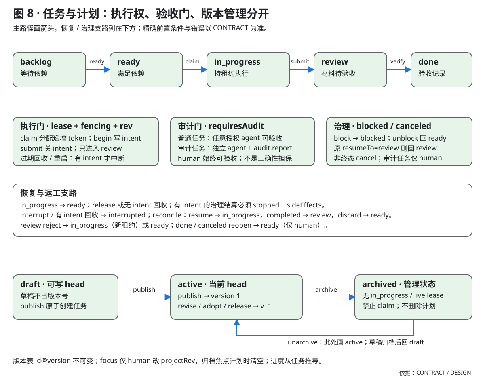
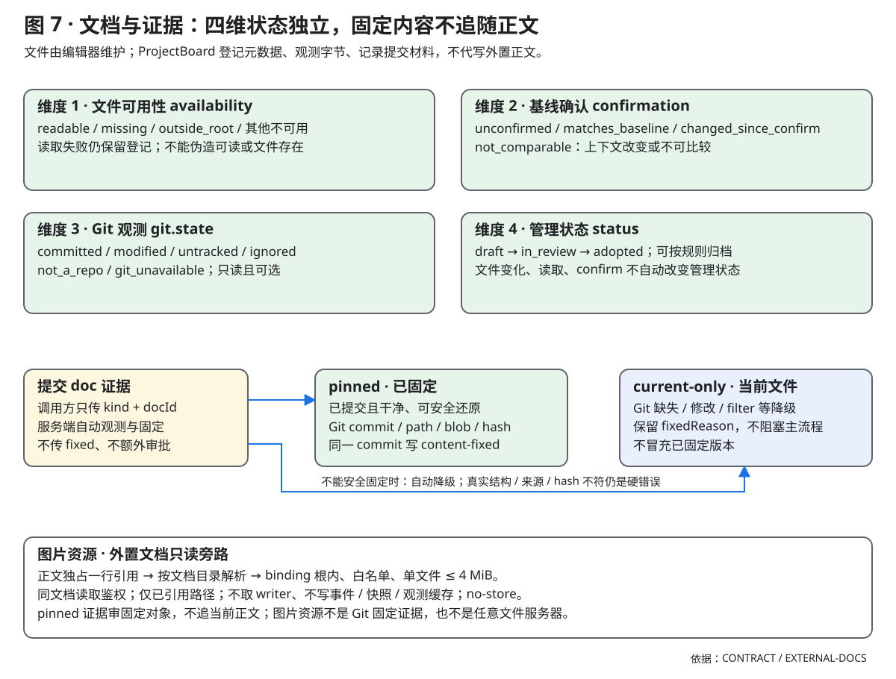

# ProjectBoard（项目板）— DSH 跨会话项目状态机插件设计方案

> 状态：审查治理候选的设计与边界；部署能力以实际运行构建为准。
> 目标读者：项目作者、实现者、审阅者。
> 结论先行：这不是一个"看板 UI + 几个 CRUD 工具"，而是一个**独立于会话的持久状态机**；看板只是它的一个投影，模型只是它的一个客户端。

---

## 0. TL;DR

跨会话推进之所以不可靠，根因不是"模型记性差"，而是**状态的所有权没有从模型转移到系统**：会话里模型是唯一的状态机执行者，会话一断，执行者消失，状态只剩自然语言叙述，下一个会话只能"相信"叙述，无法"验证"叙述。

ProjectBoard 做一次所有权反转：

1. **项目状态独立于会话**：append-only 提交日志 + 纯函数折叠，会话只是随时会死的执行器。
2. **模型只能发命令，不能设状态**：所有跃迁由代码里的转移表与守卫决定，非法命令被拒绝并给出可执行的下一步。
3. **提交记录材料，验收显式决定，进度只能推导**：没有"完成百分比"字段；done 需要 evidence + verify，progress 从任务状态算出来。
4. **并发用租约 + fencing token**：同一任务同一时刻只有一个写者；过期写者的提交会被拒绝，而不是覆盖。
5. **崩溃用 intent WAL + 幂等命令 + 对账状态**：副作用前先写 intent，崩溃后任务进入 interrupted，下一个会话必须显式对账，不能假装没发生。

一句话：**把模型从"状态的持有者"降级为"状态的客户端"，把状态机从提示词里搬进代码里。**

---

## 1. 问题定义

### 1.1 现有原语的边界

DSH 已经有三套与"计划/任务"相关的东西，但它们都不是项目级的持久状态机：

| 原语 | 持久化位置 | 作用域 | 能力 | 关键缺口 |
|---|---|---|---|---|
| `todo_write` | 会话日志 `todo/write` 事件 | 单个 agent 会话 | 整表替换、UI 可见、跨 turn 保留 | 不能跨会话读；无 id、无 CAS、无租约；fork 后两份分叉；turn/start 会把投影清空 |
| `goal` | 会话日志 `goal/change` 事件 | 单个会话 | 单目标、CAS revision、严格重放、四阶段 | 一个会话最多一个目标；不能跨会话读（要求精确 live Agent）；无任务分解、无文档、无看板；activation 进程内 |
| plan mode | 会话日志 `plan/mode` | 单个会话 | 计划评审、人工批准 | 计划是文本，不绑定任务；批准后没有执行状态 |
| 会话日志 | 每会话 JSONL | 单会话 | 完整审计、重放、compaction | 跨会话不可查询；状态在自然语言里会丢 |
| 仓库文件 | 工作区 | 无结构 | 人/AI 都能写 | 无版本、无锁、无证据、无状态机 |

结论：**跨会话项目状态必须是一个新服务**，不能靠复用 todo/goal/plan 拼出来。它们的正确性技巧可以借用，但作用域不对。

### 1.2 失效模式

下面每一条都对应一个机制，后文会逐一展开。这不是假设清单，而是设计需求清单。

| # | 失效现象 | 根因 | 现有机制为何挡不住 | 本方案对策 |
|---|---|---|---|---|
| F1 | 新会话不知道做到哪，重复劳动或跳过关键步骤 | 上下文是缓存，会被压缩/截断/重启清掉 | todo 不跨会话；goal 只有一句 objective | 持久状态 + 每次装配自动注入的 digest |
| F2 | 用旧快照覆盖新状态（lost update） | 没有 expected revision | todo 整表覆盖；plan 后写赢 | 每条命令带 `expectedRev`，冲突显式返回 409 |
| F3 | 两个会话/子代理同时改同一任务 | 没有所有权 | todo/goal 都没有租约 | 单写者 + lease + fencing token |
| F4 | 工具超时/进程崩溃，副作用已发生但状态没记 | 没有 WAL | 会话只记录工具调用，不记录"世界变了" | work intent → result 两阶段；崩溃后 interrupted + 对账 |
| F5 | 任务被标完成，但产物不存在/不对 | 自述即事实 | goal 的 complete 只需要匹配 ref | evidence（文件哈希/命令结果/doc rev）+ verify 门 |
| F6 | 进度百分比拍脑袋 | 百分比是可写字段 | 没有进度模型 | progress 只从任务状态推导；另给 verified 比例 |
| F7 | 计划改了，任务没跟上 | 计划是文本，不是契约 | plan mode 批准即结束 | 版本化 plan + 原子发布 + orphan 检测 |
| F8 | 子智能体干到一半失联，父级不知道 | 没有租约/对账 | 子代理只有自己的 todo | scoped grant + lease 过期 + 父级对账 |
| F9 | 文档被直接编辑，和任务状态脱节 | 文件即真相 | 文件系统没有修订语义 | 内容寻址 + doc rev + 外部改动 drift 检测 |
| F10 | 人/代理绕过流程，无法追责 | 没有审计 | 日志只有会话内 | 角色 + override 事件 + 哈希链 |

### 1.3 目标与非目标

**目标**

- 一个工作区对应一个项目，项目状态跨会话、跨进程重启、跨 fork 一致。
- 任务/计划/文档/进度四类对象有明确的、代码可执行的转移规则。
- 模型在任何时刻都能用很小的 token 成本拿到"我现在该做什么、什么不能做、哪里有不确定性"。
- 冲突、崩溃、失联都能被**显式暴露**，而不是被静默吞掉。
- 看板是同一份状态的只读/命令投影，不是第二份数据。

**非目标（v1）**

- 不是通用项目管理：不做甘特图、资源排期、工时、跨项目组合管理。
- 不是多人协作/权限系统：单机单用户，人通过本机 UI 操作；LAN/多用户留给 v2。
- 不内置 autopilot：v1 由人开新会话，插件负责把状态交接好；自动续跑是可选 M5。
- 不替代 git / issue tracker：可以导出、可以将来做 adapter，但不做双向同步。
- 不评估模型回答质量：只保证"状态跃迁"正确，不保证"工作本身"正确。

---

## 2. 设计立场

这九条是后面所有取舍的依据。出现争议时，先回到这里。

**P1. 状态在存储里，不在上下文里。**
会话上下文是缓存，允许丢、允许压缩、允许过期。任何"只存在于对话里"的项目事实都视为不存在。

**P2. 命令，而不是写入。**
模型不能 `PUT state`。它只能提交一个意图（claim/submit/block/...），由代码检查前置条件、决定是否接受、生成事件。拒绝时要告诉它"为什么"和"下一步怎么做"。

**P3. 事实与视图分离。**
append-only 事件是事实；看板、进度、digest 都是投影。投影可以重建、可以改版，事实不能改。

**P4. 证据，而不是自述。**
文件/文档内容指纹是观测，命令/测试结果是提交者报告；材料覆盖不证明结论正确。submit/reconcile completed 只进入 review，获授权的显式 verify 才记录验收。

**P4.1 人工豁免是责任交接，不是降级开关。**

`acknowledgeDrift` 只有 human 能在 review→done 时使用；它不是绕过安全策略的小路，而是把“这次验收的严谨度够不够”的判断交还给项目所有者。能 refresh 的 file 漂移优先 refresh；豁免用于提交后已人工复核的内容/环境变化，不能用来把未满足的 acceptance 变成满足、伪称交付正确或隐去未观测事实、或让 agent 绕过独立性限制。每次豁免写 `waivedDrift`（理由、时间、warnings）并保留 health 告警，事后可复核。

**P4.2 安全感由可追溯提供，而不是拦截。**

拦截只决定“这一次能不能做”；可追溯才能回答“谁、依据什么、做了什么、后来谁接受了”。这条原则分两侧，不能混用：

- **Agent 不得豁免证据漂移**：submit/reconcile 进入 review 前，完整性错误与内容漂移直接打回（409、零落盘、lease 保留）；verify 时同样阻断。普通任务可由任意授权 agent 显式验收，包括 worker；审计门要求独立 agent 带报告，且 review 期间 agent 不得改门。两种通过均记录验收者与证据范围。
- **人（owner/verifier）不以死路拦截**：人需要看到事实、知道谁能修、有哪些合法出路；面向人的硬底线只保留“记录会失真”的完整性问题，freshness 由人选择 refresh/waive/返工。严格度属于项目所有者，系统不替人做风险偏好。
- 每个阻断都要留下可复核的记录，并给出至少一条非豁免的合法出路；没有出路的拦截只会训练人绕过系统，反而降低可追溯性。
- 严格度应可声明、可审计、可回退；放宽不删除历史，放宽本身也是记录。
- 过度限制对人不是安全，是另一种失败模式：它把判断成本转嫁给操作者，却不提供更多事实。

**P5. 冲突显式化。**
并发不是错误，静默覆盖才是。冲突返回当前状态和差异，让调用方重新决策；绝不自动 merge、绝不 last-write-wins。

**P6. 崩溃是可预期事件。**
任何时刻都可能断电、超时、被杀。写路径必须回答：崩在哪一步？重启后看到什么？谁负责对账？

**P7. 会话是客户端。**
一个会话可以创建、恢复、fork、销毁；项目不随会话生死。会话只持有"租约"这种短期的、可过期的执行权。

**P8. 不信任，但不阻碍。**
默认不相信模型的完成声明，但也不把它当敌人：命令错误要可读、可恢复，不能让人和 AI 陷入"状态机吵架"。

**P9. 同一份文本只走一条投递通道。**
用途不同就分叉，不要复用同一个字符串——digest 既当系统提示又当工具结果，就必然有一次是白写的。省上下文只能在生成时省（写的时候就短），不靠事后裁剪：裁剪会让裁剪点之后的 KV cache 全失效。

---

## 3. 领域模型

### 3.1 词汇表

| 概念 | 一句话职责 | 关键字段 | 生命周期 |
|---|---|---|---|
| **Project** | 状态容器与策略边界 | id、workspacePath、phase、rev、policy | active → paused → archived |
| **Plan** | 版本化的任务契约 | id、version、status、steps[]、assumptions[] | draft → published → superseded |
| **Task** | 可被租约拥有的工作单元 | id、state、rev、deps[]、acceptance[]、planRef | 见状态机 |
| **Doc** | 带修订的内容对象 | id、rev、hash、kind、links[] | 每次 put 产生新 rev |
| **Evidence** | 完成的凭据 | id、kind、ref、hash、verifiedAt | 附着在 task 上，不可改，可作废 |
| **Lease** | 执行权（短期） | taskId、sessionId、epoch、token、expiresAt | 进程内；grant/revoke/expire 有事件 |
| **WorkIntent** | 副作用的预写日志 | id、taskId、token、plannedSteps[]、status | open → closed / abandoned |
| **SessionBinding** | 执行器注册 | sessionId、projectId、role、epoch | attach → detach |
| **Commit** | 一次原子事实批次 | seq、prevHash、hash、cmdId、events[] | 永久 |

这三组抽象分别回答三个问题：**时间上发生了什么**（commit/event/fold）、**现在谁有权做什么**（binding/lease/fencing）、**模型该知道什么**（digest/allowedOps/错误码）。

边界表：

| 层 | 谁持有 | 模型能看到 | 模型能改 |
|---|---|---|---|
| 事实（commits） | 系统 | 否，只能看投影 | 否 |
| 状态（task/plan/doc） | 系统 | digest / board 投影 | 只能通过命令 |
| 执行权（lease） | 系统 | 自己持有的 lease | claim / release |
| 意图（intent） | 系统 | 自己的 open intent | begin / reconcile |
| 证据（evidence） | 系统 | 任务上的证据列表 | submit 时附上 |
| 简报（digest） | 派生 | 是 | 否 |

关系：

~~~text
Project 1 ─── * Plan 1 ─── * Task 1 ─── * Evidence
   │                          │
   │                          ├── 0..1 live Lease
   │                          └── 0..1 open WorkIntent
   ├── * Doc ─── * Task        (links)
   └── * SessionBinding ─── * Lease
~~~

### 3.2 任务状态机

- 任务主路径是 backlog → ready → in_progress → review → done；submit 不等于完成。
- claim/begin/submit 受租约、fencing token 与版本守卫约束；中断后必须 reconcile。
- 普通任务允许授权 agent 验收；审计任务要求独立 agent 报告，human 验收始终可用。
- 计划 head 的现行状态是 draft/active/archived；版本表不可变，修订与成员调整产生新版本。
- focus 仅由 human 设置；归档清空对应焦点并禁止新 claim；归档草稿恢复为 draft。

**图只是示意，转移表才是事实源。** 实现时守卫从表生成，测试也对着表跑；不要在两处各写一份规则。

~~~mermaid
stateDiagram-v2
    [*] --> backlog: create
    backlog --> ready: deps_satisfied
    ready --> in_progress: claim
    in_progress --> in_progress: begin(intent)
    in_progress --> review: submit
    in_progress --> blocked: block
    blocked --> ready: unblock
    blocked --> in_progress: unblock(resume)
    in_progress --> ready: release
    in_progress --> interrupted: lease_expired(open_intent)
    in_progress --> ready: lease_expired(no_intent)
    interrupted --> in_progress: reconcile_resume
    interrupted --> review: reconcile_completed
    interrupted --> ready: reconcile_discard
    review --> done: verify
    review --> in_progress: reject
    review --> blocked: block
    done --> ready: reopen(override)
    backlog --> canceled: cancel
    ready --> canceled: cancel
    blocked --> canceled: cancel
    canceled --> [*]
    done --> [*]
~~~

转移表（v1，15 条主路径）：

| # | From | Command | To | 守卫 | 产出事件 |
|---|---|---|---|---|---|
| T1 | — | create | backlog | title 非空；至少 1 条 acceptance（draft 可放宽） | task/created |
| T2 | backlog | ready | ready | 所有 deps 为 done（或有 waiver）且 acceptance 非空 | task/readied |
| T3 | ready | claim | in_progress | 项目 active；无 live lease；WIP 未满；deps done | lease/granted + task/claimed |
| T4 | in_progress | begin | in_progress | lease 有效；无 open intent | work/intent |
| T5 | in_progress | submit | review | lease 有效；有 open intent（或 policy 允许无 intent）；每条 acceptance 有合格 evidence | work/result + task/submitted（只进入 review） |
| T6 | in_progress / review | block | blocked | 非 human 需 live lease + fencingToken；有 open intent 必须 `intent.outcome=stopped` + sideEffects；review 可无 lease | work/abandoned（有 intent）+ lease/revoked（in_progress）+ task/blocked |
| T7 | in_progress | release | ready | lease + token；有 open intent 必须 `stopped` + sideEffects | work/abandoned + lease/revoked + task/released |
| T8 | in_progress | expire | interrupted / ready | 心跳超时；有 open intent → interrupted，否则 ready | lease/expired + task/interrupted 或 task/readied |
| T9 | interrupted | reconcile | in_progress / review / ready | 新 lease；note 非空；三种选择各自要求；写 resolution=redo/applied/discarded | task/reconciled + 相应事件 |
| T10 | review | verify | done | human 或审计门的独立 agent（带 audit.report）；所有 acceptance 满足；内容观测通过 | task/verified |
| T11 | review | reject | in_progress / ready | reason 非空；有 live lease 时非 human 校验 token；in_progress 需新 lease | task/rejected |
| T12 | blocked | unblock | resumeTo | blocker 已解决/waiver；有 open intent 拒绝（先 interrupt） | task/unblocked |
| T13 | 任意非终态 | cancel | canceled | owner/human；有 live lease 时非 human 校验 token；有 open intent 必须 `stopped` + sideEffects | work/abandoned + lease/revoked + task/canceled |
| T14 | done / canceled | reopen | ready | 仅 human override | task/reopened |
| T15 | in_progress（正常；遗留异常状态仅 human） | interrupt | interrupted | note 必填；in_progress 需 lease（human 可 force）；有 open intent 时保留不关闭 | lease/revoked（若有）+ task/interrupted |

项目级写闸（T 表外）：

| # | From | Command | To | 守卫 | 产出事件 |
|---|---|---|---|---|---|
| P1 | active/paused | project.update(phase=archived) | archived | 无 in_progress / live lease / open intent，否则 `project-has-live-work` | project/updated |
| P2 | archived | project.update(phase=active/paused) | active/paused | 仅 unarchive；同 commit 携带恢复事件 | project/updated + task/interrupted 或 task/readied |

每个任务的读模型都附带 `allowedOps`：由转移表 + 角色 + 当前 lease 计算出的合法操作列表（含不可用原因）。模型不用猜，UI 也据此禁用按钮；这是把"状态机知识"同时喂给人和模型的最小接口。

几条容易争议、这里先定死：

- **`blocked` 不是"从 in_progress 走出来的一个列"**，它是任意活跃状态的侧挂状态，记录 `resumeTo`。看板上放在 "Attention" 托盘，不占正式列。
- **`interrupted` 是独立状态，不是 in_progress 的一个 flag。** 它强制下一个会话先对账，是崩溃恢复的核心。
- **`done` 不可由 worker 直接设置。** worker 只能 submit；verify 由 human 或审计门的独立 agent 带报告显式执行。
- **`canceled` 与 `done` 都是终态**；reopen 必须 human override，并留下审计事件。
- **submit/reconcile completed 一律只进 review**；旧 auto/policy 记录按原值保留，不驱动新自动完成。新 policy.verification 仅 manual。
- **依赖完成时的级联 ready 与主命令在同一个 commit 里**，不允许"任务 done 了但依赖还没 ready"的中间态。

### 3.3 计划、项目、文档

- 可用性、基线确认、Git 观测、管理状态是四个独立维度，文件变化不自动改变管理状态。
- 外置正文由编辑器维护；登记与确认不等于对内容正确性的验收。
- 提交 doc 证据时服务端自动固定干净的已提交 Git 字节；无法安全固定时标 current-only 和原因。
- pinned 审计只针对固定对象，不追随当前正文；不可观测与真实身份/hash 不符要分别处理。
- 图片只读、只限正文已引用路径和 binding 根内白名单文件，单文件上限 4 MiB，不获取 writer。

**Plan（v2：多实例；设计见 [计划模块](<modules/plan/contract.md>)）**

- 计划是 initiative 级容器：一个项目可有 N 个计划；`PlanHead` 保存身份与状态（id/title/status/currentVersion），`PlanVersion` 保存不可变快照。
- `draft`：可编辑，不建任务、不参与进度；只在计划列表可见，默认不进看板。
- `active`（发布后）：原子发布；本次 commit 同时创建/绑定所有 step 对应的 task。发布前校验：至少 1 step（step 可为空）、每个 task 至少 1 条 acceptance、依赖无环、任务 id 不重复、同一 task 只在一个 step。
- `archived`：显式退役，只读；归档前要求无 in_progress、无 live lease；不删除历史。
- `superseded`：版本级状态；revise 产生 `version+1`，旧版本只读，任务保留 `planRef{version}`。
- 修订移除的任务标记 `orphaned`，**不删除**；`plan.release` 则是显式移出（planRef 置空，任务回到计划外）。
- `focusPlanId` 只是人的关注偏好，不构成唯一性；计划外任务是合法的 inbox 状态。
- 多实例、draft/archived、focus、adopt/release 已由 C1/C2/H1 落地；浏览器半的计划列表与编辑在 U1/U2。

**Project**

- `active`：允许 claim；`paused`：不允许新 claim，已有 lease 可以 submit/release；`archived`：全只读——唯一允许的写是 `project.update(phase=active|paused)`（unarchive），入口与 `_appendEvents` 双层拦截其他写；unarchive 同 commit 恢复 in_progress → interrupted/ready；attach/detach 只留内存绑定，recover/expire 跳过。
- policy：`maxInProgress`、`maxPerSession`、`leaseTtlSec`、`leaseGraceSec`、`maxRenewalsWithoutProgress`、`verification`（manual；历史 auto 只读）、`requireIntentFor`（哪些任务必须先 begin）。

**Doc**

- 每次 `put` 产生新 rev，必须带 `baseRev`；不匹配返回冲突 + 当前正文。
- 正文存内容寻址 blob（`sha256`），事件只存 `{docId, rev, hash, size, title, kind}`。同一正文只存一份。
- 文档可以 link 到 task/plan step；task 的 evidence 可以引用 `docId@rev`。
- blob 被直接改写或丢失时，fsck 重算 hash 会发现并发 `doc/drift` 事件，健康面板标红；导出的镜像文件不是事实源，重新导入时同样按 hash 校验。

### 3.4 不变量

这些不是"最好满足"，而是每次 commit / replay / fsck 都要检查的硬约束。违反 = 拒绝写入或项目进入只读。

| # | 不变量 | 检查时机 | 违反处理 |
|---|---|---|---|
| I1 | commit seq 连续；prevHash 链接正确 | replay / fsck | 默认冷开拒绝；离线显式 salvage 只读前缀、非当前状态 |
| I2 | 每个实体的 `rev` 严格 +1；id 不可复用 | replay | 拒绝加载该项目 |
| I3 | 任务状态 ∈ 8 状态；转移 ∈ 转移表 | commit | illegal-transition |
| I4 | 最多 1 个 live lease/task；live lease ⇒ in_progress | commit + fsck | 拒绝/告警 |
| I5 | in_progress ⇒ 有 live lease（进程内）或处于待对账 | commit | 拒绝 |
| I6 | open intent ⇒ 任务 ∈ {in_progress, interrupted}；关闭 open intent 只允许 submit(closed)、reconcile(resolution)、或治理命令(block/release/cancel/override) 带 `outcome=stopped` + sideEffects；禁止以 unknown 关闭 | commit | 拒绝 |
| I7 | done ⇒ verifiedAt 非空 ∧ 所有 acceptance 满足 ∧ evidence 校验通过 | commit | verify 拒绝 |
| I8 | ready ⇒ 所有 deps done（或有 waiver 事件） | commit | 拒绝 |
| I9 | 任务依赖无环 | publish / fsck | 拒绝发布 |
| I10 | doc rev/hash 与 blob 一致；blob 存在 | commit / fsck | 拒绝写入/告警 |
| I11 | published plan ⇒ 所有 step 任务存在且 planRef 匹配（或 orphaned） | publish / fsck | 拒绝发布 |
| I12 | 每个 commit 的 cmdId 唯一 | replay | 重复返回原结果 |
| I13 | 每个 commit 有 actor；角色允许该命令 | commit | forbidden-role |
| I14 | archived 项目不再产生事件（除 unarchive；unarchive 同 commit 可携带恢复事件） | commit | 拒绝 |
| I15 | digest 是状态的纯函数（同状态同输出） | 测试 | 测试失败 |
| I16 | 每个 `task.planRef` 指向存在的 plan@version，且该版本某个 step 含该 task | commit / fsck | 拒绝/告警 |
| I17 | `planHeads[id].currentVersion` 指向存在的版本；active ⇒ ≥1，draft ⇒ 0 | commit / fsck | 拒绝 |
| I18 | `focusPlanId` 为空或指向 active 计划 | commit / fsck | 拒绝/告警 |
| I19 | 计划标题在项目内唯一（大小写不敏感，含 archived） | create/rename | plan-title-taken |
| I20 | 一个任务最多属于一个计划；同一计划内一个 task 只出现在一个 step | publish/revise/adopt/release/fsck | 拒绝 |
| I21 | archived 计划不产生任务状态变化；归档前无 in_progress / live lease；进入 in_progress 的路径必须检查 planRef 计划未归档 | archive / claim / unblock / reconcile-resume / reopen / reject / override | plan-has-live-work / plan-archived |
| I22 | intent 关闭必须带结算记录（status + closeReason/resolution + actor + at）；历史记录缺字段不追溯，但新命令不得产生无结算的 abandoned/closed | commit | 拒绝 |

### 3.5 进度只能推导

不存在 `task.progressPercent` 这种字段。API 也不提供"设置进度"的命令。进度是一个纯函数：

~~~text
weight(t)      = t.weight ?? 1
totalWeight    = Σ weight(t)   for t.state ∉ {canceled}
doneWeight     = Σ weight(t)   for t.state = done
progress       = doneWeight / totalWeight          (0..1)
verifiedRatio  = Σ weight(t) [t.verified] / doneWeight
attention      = count(interrupted) + count(expired leases) + count(open intents)
~~~

看板显示三个数，而不是一个假的百分比：**完成度 / 已验证比例 / 待对账数**。
"完成度 80%"但"已验证 35%"是一个诚实且有信息量的状态；"80%"单独出现则是幻觉。

时间维度的进度也不是手工填的：每次状态跃迁都有事件时间戳，所以可以重放出真实的 burndown、cycle time、time-in-state。这是事件溯源的免费收益。

---

## 4. 架构

### 4.1 分层与依赖方向

六边形架构，依赖只向内。M1–M4 拆分后的实际落点（详情见
[ARCHITECTURE.md](./ARCHITECTURE.md)）：

~~~text
┌──────────────── DSH 适配层：lib/host + src/client ─────────────────┐
│ 5 个 model tools（tools/*） │ prompt │ REST routes/* │ client bundle │
│ agent/created / disposed    │ session│ commands.js   │ src/client    │
└──────────────────────────────┬─────────────────────────────────────┘
                               │ commands / queries（ProjectHandle）
┌──────────────────────────────▼─────────────────────────────────────┐
│ 应用层 lib/core                                                    │
│ ProjectService（项目注册表）· ProjectHandle（命令总线）              │
│ commands/*（每域）· lease · digest · fsck · 策略                    │
└──────────────────────────────┬─────────────────────────────────────┘
                               │ 纯函数调用 + 状态快照
┌──────────────────────────────▼─────────────────────────────────────┐
│ 领域层（规则为纯函数；不直接碰 DSH；存储只经 store 端口）             │
│ model.js（状态/转移/守卫/reducer）· normalize.js（输入/证据归一）    │
│ contracts.js（事件构造）· views.js（读模型投影）                     │
└──────────────────────────────┬─────────────────────────────────────┘
                               │ ports
┌──────────────────────────────▼─────────────────────────────────────┐
│ lib/core/store：JsonlStore + hash chain + snapshot + blobs          │
│ store/lock.js（文件锁）│ store/format.js（格式/重放）│ store/files.js │
└────────────────────────────────────────────────────────────────────┘
~~~

硬规则（`scripts/maintainability-audit.mjs` 机器检查）：

- `lib/shared` 零依赖，只放枚举/命令名/错误码/API 模板。
- `lib/core` 可以 import `node:*` 与 `lib/shared`，不 import DSH，也不 import `lib/host` / `src/client`。
- `lib/host` 是唯一接触 DSH 包的层；它把 agent/session/tool 翻译成 actor 和命令。
  换 DSH 版本只改这一层。
- `src/client` 只 import `react` 与同层模块（允许 `lib/shared`），用构建产物运行。
- 领域规则不放在 host，也不放在 views：`allowedOps()` 与命令守卫是唯一判断点。
- 这样核心可以用 `node` 直接跑测试，不需要启动 DSH。

### 4.2 包结构

v1 是**单包双半**（`lib` 宿主/核心 + `src/client` 浏览器半），不是 3 个 npm 包：

~~~text
dsh-project-board/
  package.json            # main=lib/index.js, ./client=lib/client.js, dsh.client 元数据
  lib/
    index.js              # cordis 插件入口：name/inject/apply
    client.js             # 浏览器 bundle（esbuild 生成物，提交进仓库）
    shared/contract.js    # 枚举 / op / 错误码 / API_PATHS / TOOL_NAMES
    host/
      tools/*.js          # 5 个 defineTool（按域拆；tools.js 是兼容壳）
      routes/*.js         # /project-board/api 的资源处理（routes.js 分发）
      prompt.js           # 每个 agent 的 scoped section + digest
      lifecycle.js        # agent/created、agent/disposed
      auth.js / util.js   # token 校验 / body 与错误映射
    core/
      service.js          # 项目注册表、handle 复用
      handle.js           # 命令总线（校验、租约过期、append）
      commands/*.js       # 命令实现（task-* / plan-* / project / doc / session）
      lease.js normalize.js contracts.js evidence.js
      model.js            # 状态、转移表、守卫、reducer
      store.js            # JsonlStore 门面 + store/{format,lock,files}.js
      views.js digest.js fsck.js repair.js errors.js util.js
  src/client/             # 浏览器半源码（React，无 JSX）
    index.js              # apply + 4 个 slot；views/* 页面
    styles.css            # 设计 tokens + primitives + pages（真 CSS）
    transport.js hooks.js races.js 等
  test/                   # core / client / host / architecture-map
  scripts/deck.mjs        # 不启 DSH 也能驱动核心的 CLI harness
  tools/build/            # 仅开发期 esbuild 工具链（独立 package.json）
~~~

**构建决策**：浏览器半用 esbuild（仅开发期，`npm run build:client`）打包成单个
`lib/client.js` + source map，**产物提交进仓库**、插件运行时不再构建；core/host 是
手写 ESM，无构建步骤。构建工具隔离在 `tools/build`，根目录保持零运行时依赖。
TypeScript 在 `tools/typescript/` 隔离安装，仅以 `noEmit` 做开发期后端检查；共享基础规则与 Node 专用配置分离，现有 JS 未全量开启语义检查。工具链试点与边界见 [TypeScript 开发工具链](<governance/TYPESCRIPT.md>)；全量类型迁移、前端 TS/TSX 与严格化不属于当前实现。

理由：单包避免版本偏移和装配复杂度；内部模块边界已经足够清晰。等核心稳定、确实需要复用时再拆 `core` 包。单包也符合 dsh-button-plugin 已验证的装配方式（junction + cordis.patch.yml）。

### 4.3 存储格式

**决策：自己的 append-only JSONL，而不是 `storageDomain`。**
评估过 storage-domain：它的 `update()` 是单进程串行、**没有 CAS/冲突码**、open 时会全量加载所有记录、也没有跨进程通知。项目日志需要"一次追加一个原子批次 + 哈希链 + 快照 + 跨进程只读降级"，JSONL 更直接。EventStore 是端口，M3 可以加一个 storageDomain adapter 做对比，但 v1 不引入这层不确定性。

目录（默认在 DSH home 下，不在工作区里）：

~~~text
~/.dsh/project-board/
  projects/
    prj_7f3a.../
      meta.json          # {schemaVersion, workspacePath, name, createdAt}
      commits.jsonl      # 一行一个 commit（一次命令的原子批次）
      snapshot.json      # {lastSeq, lastHash, state}（每 200 commit 一次）
      blobs/<sha256>     # 文档正文，内容寻址
      lock.json          # {pid, hostname, nonce, heartbeatAt}（跨进程只读降级）
      lock.json.claim/   # 原子获取目录（owner.json；同机活 pid 不按年龄回收）
      lock.json.hb.<nonce> # 当前 acquisition 的心跳文件
~~~

为什么不在工作区：避免 agent 用普通 `write` 工具绕过状态机改状态；避免污染 git；备份/迁移只涉及一个目录。文档需要给人看时用 `export` 命令导出 markdown 到仓库，而不是让仓库成为第二事实源。

**Commit 格式（一行）：**

~~~json
{
  "v": 1,
  "seq": 42,
  "prev": "sha256:...",
  "hash": "sha256:...",
  "at": "2026-10-21T03:12:44.120Z",
  "actor": {"kind":"agent","sessionId":"session-abc","agentId":"session-abc","callId":"call-7"},
  "cmdId": "cmd_01J...",
  "baseRev": 41,
  "events": [
    {"type":"task/claimed","taskId":"tsk_...","rev":3,"data":{...完整快照...}}
  ]
}
~~~

三个关键点：

1. **一次命令 = 一个 commit = 一行 = 一个原子写。** 多实体级联（done → 依赖 ready）在同一行里，不会出现半个状态。
2. **事件携带实体的完整后置快照**（借用 dsh-goal 的做法）。重放只做形状/连续性校验，不重新执行业务规则；业务规则只在命令时跑一次。这样"代码升级导致重放结果变化"的风险被消掉。
3. **哈希链**：`hash = sha256(canonical(commit 去掉 hash))`，`prev` 指向上一条。它能发现意外损坏和随手篡改，但不是防定向攻击的签名（agent 有文件权限时能重算整条链）。v2 可以加 HMAC，密钥放在项目目录外。

**写入协议：**

~~~text
tool call
  → 参数校验
  → 解析 actor / session / project
  → 取项目内存锁（async mutex）
  → 幂等检查：cmdId 已存在？→ 返回原 commit 的结果
  → 对当前状态跑守卫
  → 生成事件批次（每个实体 rev+1）
  → 序列化 commit + 计算 hash
  → append 一行 + fsync
  → 更新内存状态
  → 释放锁
  → 返回 {committed:true, rev, events, view}
~~~

**关键约定：commit 行 fsync + 哈希链成立即 committed。** 之后的 meta / registry 更新是派生副作用：失败不回滚、不向调用方返回失败，只在结果里带 `warnings`（如 `relocate-meta-failed`）；snapshot 是纯优化，写失败静默忽略（不影响命令结果），否则模型会重试，而重试必须靠 cmdId 幂等兜住。返回值里用 `committed:true` 明确这一点。`project.relocate` 的 meta.json/pathIndex 写失败后，下一次 open 从日志里的 `project/updated.workspacePath` 自愈 meta 与 path index（幂等，best-effort；失败留 `metaWarning`）。

**快照与恢复：**

- 每 200 个 commit 写一次 `snapshot.json.tmp` → `rename`，记录 `lastSeq/lastHash/state`。
- 冷开：逐物理行解析并校验完整 version/seq/prev/hash 链与 events 数组，第一处损坏拒绝（`hash-chain-broken` 503；不支持版本 `unsupported-version` 409），details 含 `validSeq/validHash/line/reason`。随后才允许可写尾规范化，再读 snapshot 校验对应 seq/hash 并重放；snapshot 不一致就全量重放。
- 缺 LF 的完整合法 JSON commit 保留；可写 open 补 LF，只有不可解析且未终止的最后片段可被省略。普通只读打开不修任何尾部；中段坏 JSON/hash/seq/prev/version 不得先改日志再报错。普通可写 open 校验前可能创建目录和自身锁，失败只清自身锁；只读离线 salvage 则完全不写文件。
- salvage 是独立离线只读诊断：必须显式 root/project/view，直接扫描 meta+日志，不初始化 service/handle、不 recover、不信 snapshot。board/health/events 仅投影合法且理解的完整 commit 前缀，统一标“只读前缀，非当前状态”，返回 validSeq/validHash 与第一处物理行诊断。遇未知事件/版本也停在该 commit 之前，partial exit 2，不伪装成功 current；普通 reducer 的未知事件 no-op 兼容行为不由此改变。
- repair-log 是显式写修复入口，与 salvage 分离。默认 fork 规划；`--truncate-to-valid-prefix` 才授权丢弃坏 JSON/seq/prev/hash 所在物理行及全部后继，RPO=validSeq，未知事件/不支持版本拒写。dry-run 零写，apply 必须 `--confirm-data-loss <validHash>`，拒绝现有锁/claim（含 stale，不支持 force）、复用合作写锁、独占备份+fsync，再复核原字节及锁后原子替换；不自动清旧锁、不回滚外部副作用。精确接口/失败及回退边界见 CONTRACT §5.1。
- blob 先写、commit 后写：崩溃最多留下孤儿 blob，GC 扫描未引用 blob 即可，不会出现"事件引用了不存在的正文"。
- 日志不删：1 KB/commit，10 万 commit 约 100 MB，项目级完全可接受；需要归档时按项目整体导出/搬走，不做原地裁剪（裁剪会破坏哈希链）。
- 只读进程不缓存过期状态：每次读前 `stat` 日志的 size/mtime，变化则从上次 seq 增量重放；写权限只属于持锁进程。
- meta.json 是项目身份的派生缓存：open 时若 log 的 `project` 与 meta 不一致（relocate 后写失败/被篡改），重写 meta.json 与 pathIndex；失败只记 `metaWarning`，不阻断打开。

运行时硬切 schema v3：新 genesis/meta/project 为3；缺失版本按2并拒开，在可写尾修复前检查最终 schema。维护者停宿主后从发布包外显式迁移；追加 project/updated + 全量 task/updated + 受影响草稿的既有 plan/updated，不新增事件，不重写原提交。meta/snapshot3，已迁移 no-op。旧构建可能静默丢门，回滚仅恢复迁移前备份 + 旧构建，详见 [迁移](<operations/MIGRATION.md>)。

### 4.4 并发：单写者 + CAS + fencing

三层保护，缺一不可：

**第一层：进程内单写者。** 每个项目一个 async mutex，所有命令串行。单进程内不会有两个命令同时读-改-写。

**第二层：CAS（expected revision）。**
- 项目级 `baseRev`：命令可带，用于检测"我基于的状态已经旧了"。
- 实体级 `expectedRev`：修改已存在实体时必带。
- 不匹配 → `stale-revision`，返回当前 rev + 当前视图 + 建议动作。绝不自动合并。

**第三层：租约 + fencing token。**
租约解决"谁能写"，fencing 解决"过期的人还在写"：

- `claim` 时分配一个项目内单调递增的 `token`（fencing token）。计数器随 `lease/granted` 事件持久化，重启后从 `max(token)+1` 继续；旧 token 永远小于当前 token。
- `submit/release/block/interrupt` 必须带 token；`cancel/reject` 在有 live lease 时非 human 也必须带 token；token 不是当前 live lease 的 token → `fencing-stale`，即使任务看起来还是 in_progress。
- 租约 TTL 默认 15 分钟；过期后还有 15 分钟宽限（`leaseGraceSec`）。宽限内 binding 未 detached、epoch 匹配、`lastSeenAt` 在 `TTL+grace` 内时，lease 仍可 `task.renew`（只改内存，不写 commit）；`maxRenewalsWithoutProgress=2`，无进展续租超限后只等回收。只有 detached / epoch 变了 / 超过宽限 / lastSeen 太旧才写 `lease/expired` + `task/interrupted|readied`；回收后旧 token/epoch 不得复活。任何工具调用都会 touch 续期（含 submit 自身），父会话 touch 只作用于自己 epoch 的 lease。
- 回收发生在命令事务内、业务计算之前：先在克隆的工作投影上应用回收，再算业务快照，避免旧快照把回收迁移改回 in_progress；回收与业务事件同一 commit，命令被拒则一起丢弃。过期且有 open intent 时，原 session（同 epoch、binding 未 detached）带原 token 用 `interrupt`（只写一条迁移，intent 保留）或 `reconcile`（一次完成）恢复；begin/submit 不享受此例外。
- 租约本身是**内存态**，不逐次心跳写日志；grant/revoke/expire 才写事件。这样避免心跳把日志撑爆，也让"进程死了租约就没了"成为天然语义。
- 跨进程：写进程用 `lock.json`（pid + nonce + 心跳）独占。获取锁先原子创建 `lock.json.claim` 目录（owner.json）；同机活 pid 无论 mtime 多旧都不回收，dead pid 才把整个 claim 目录 rename 成 tombstone。rename 后复核 tombstone 的 owner nonce 与判死快照一致：不一致说明已被替换，立即 rename 回，绝不删除；无 owner 的旧空 claim 只有 tombstone mtime 仍过期才删除。N 个进程并发抢空锁或失效锁时最多一个 writer。心跳写 nonce 作用域的 `lock.json.hb.<nonce>`，仅在拿到 claim 时顺带刷新 `lock.json`；旧持有者失去锁后心跳不会覆盖新 owner。仅同机 dead pid 可自动接管；**跨主机不自动接管**（无法确认旧持有者退出），需人工 force-unlock。append 仍复核 lock.json 的 nonce（见 4.3/7.1）。

**为什么不用 CRDT/多写者合并？** 任务状态不是可交换的计数器；"claim"本质是排他资源。租约 + 单写者更简单，也更容易向用户解释。

### 4.5 崩溃恢复：intent WAL + 对账

这是整个方案里最容易被低估、但最关键的部分。AI 的工作有外部副作用（改文件、跑命令、发请求），状态机必须能回答"副作用到底发生了没有"。

**两阶段：**

1. `begin` → 写 `work/intent`：准备做什么、预期产物、租约 token。任务仍是 in_progress。
2. 执行副作用。
3. `submit` → 写 `work/result` + evidence，关闭 intent，任务进入 review。

intent 的三种收尾：`closed`（正常 submit 或 reconcile completed）、`abandoned`（block/release/cancel/override 带结算，或 reconcile resume/discard）、`open`（崩溃/中断待对账）。**abandoned 只表示“这次尝试停止”，不表示没有副作用或已回滚**；每条 abandoned 必须记录 `closeReason`、`outcome`、`sideEffects`、`closedBy`、`closedAt`。`reconcile_resume` 会先把旧 intent 标 `abandoned`（resolution=redo），再建一个 `attempt+1` 的新 intent；`reconcile_completed` 则把旧 intent 标 `closed`（resolution=applied）并补 evidence；`reconcile_discard` 标 abandoned（resolution=discarded）。结果不明时不得用 block/release/cancel/override 清场，必须 `task.interrupt` → `interrupted` → reconcile。

**崩溃窗口：**

| 崩溃点 | 重启后看到 | 处理 |
|---|---|---|
| begin 之前 | in_progress，无 intent，租约没了 | 安全回到 ready（或由 session 重新 claim） |
| begin 之后、副作用之前 | in_progress，open intent | interrupted；对账选 discard |
| 副作用之后、submit 之前 | in_progress，open intent | interrupted；对账选 completed（补 evidence）或 resume |
| submit 的 commit 已写、响应丢失 | review/已提交 | 用同一 cmdId 重试 → deduped，返回原结果 |
| commit 写了一半（断电） | 尾行损坏 | 截断尾行，回到上一条 commit；任务仍是 in_progress + open intent → interrupted |

**可选强化（v1.5）：自动 WAL / 证据采集。** 用 `tools/pre-execute` / `tools/post-execute` 两个 waterfall，把副作用工具（`write`/`edit`/`bash`/`pwsh` 等）的工具名、参数摘要、退出码、输出摘要记进当前 open intent。它不改变工具行为、不阻塞执行，只在模型忘了手动 `begin` 时也留下痕迹；大参数只存 hash，不存全文。这是把 F4/F5 从"靠模型自觉"提升到"系统自动兜底"的关键一步。

**对账（reconcile）是强制动作，不是建议。** 三种选择都必须带 note：

- `resume`：确认副作用没发生/可重做 → 新 lease，任务回 in_progress，intent 保留（attempt+1）。
- `completed`：确认副作用已发生 → 补 evidence，任务进 review。
- `discard`：确认放弃 → intent abandoned，任务回 ready。

只要存在 interrupted 任务，digest 顶部就会一直显示"RESUME CHECKLIST"，看板也会把它放在 Attention 托盘。**不允许新 claim 把 interrupted 盖过去**（除非 human override）。

### 4.6 会话生命周期

DSH 的 `agent/created` 是 serial + awaited 的，监听器抛错会导致创建失败。所以 attach 必须"快、不抛、可降级"。

**attach（agent/created）**

1. `source ∈ {startup, resume, clear, compact}`；fork 没有独立 source，用 `session.header.parentSession/isSeeded` 识别。
2. 取 cwd：`agent.session.header.cwd`（或 `ctx.get('workingDirectory')`）。canonicalize（realpath + Windows 大小写归一）。
3. 按路径找项目；没有就什么都不做（零成本）。
4. 有项目 → 在内存里登记 `SessionBinding`，`epoch+1`；**如果是 resume，先 revoke 该 session 的所有旧 lease**（旧进程已经死了，旧 token 必须失效）。
5. 在 `agent.ctx` 上注册 scoped prompt section（见 5.3），文本 = 当前 digest；不写会话日志、不阻塞。
6. **attach 本身不写 commit**；`session/bound` 作为审计事件异步落盘，失败只记日志，绝不让会话创建失败。
7. 不做 fsck、不做全量重放——这些放在项目首次打开时做，attach 只读内存。

**运行中**

- 每次工具调用：续租（如果当前 session 持有 lease）。
- `session/event` 里的 `turn/end`：可选用作 checkpoint 时机（记录 lastSeen，不写业务事件）。
- cwd 变了：下一次工具调用时发现 binding 的 workspacePath 不匹配 → 自动 detach + 重新 attach（或返回 `wrong-project`，让模型显式处理）。

**detach（agent/disposed）**

- 释放该 session 持有的 lease（reason=session-closed）；有 open intent 的任务 → interrupted。
- 写 `session/detached` 事件（审计用），不删除 binding 历史；archived 项目只在内存更新 binding，不写事件。

**fork**

- 新 session 以新 id attach；**不继承 lease**。父会话如果还在跑，继续持有；fork 出来的会话只能只读，或等父释放/租约过期后再 claim。
- 这避免"fork 一下两个 agent 同时改一个任务"。

### 4.7 与 DSH 原语的集成

| DSH 原语 | 用法 | 注意 |
|---|---|---|
| `tools` | 注册 5 个 `defineTool`；`execute(args, exec)` 里拿 `exec.agent.id / exec.callId / exec.signal` | exec 没有 turn id/cwd；cwd 从 session header 取 |
| `systemPrompt` | 每个 agent 一个 scoped `section`（不是 context），文本动态生成 digest；order 放在靠后（如 9000），减少 KV cache 失效范围 | 空文本不贡献 token；agent 创建后注册，dispose 自动回收 |
| `webServer` | `register({kind:'prefix', path:'/project-board/api', handler})` 提供看板读写；`webserver/index-inject` 注入进程级 token | 路由不走 /api 的 browser-trust 栅栏，必须自己做 Origin + token 校验 |
| `sessionProjections` | 可选：注册 `project_focus`（当前 session 正在做的任务）供右侧栏显示 | 投影是 fold-only，不能作为看板写通道；看板状态跨会话，不能塞进 session projection |
| `goal` | 不自动创建。digest 里提示："若要跨 turn 自动续跑，用 create_goal 把当前任务作为 objective" | goal 的 resume 需要人类请求；插件不绕过产品策略 |
| `todo_write` | 项目 attach 后，提示词明确"项目任务用 project_task，不用 todo_write"；todo 只用于会话内临时步骤 | 不桥接、不同步，避免两份计划 |
| plan mode | 批准后，模型可调用 `project_plan publish` 把计划变成契约；可选监听 `exit_plan_mode` 的结果给出建议 | v1 不自动导入，避免把"评审文本"当"已承诺计划" |
| `commands` | 可选 `/deck`：status / attach / export | 不影响模型面 |
| `workspaceRegistry` | 只作为 UI 的目录列表来源，不作为项目身份 | 项目身份用 canonical path 的 hash，避免 workspace 删除/重建导致 id 漂移 |

**为什么不用 `storageDomain` 存事件？** 见 4.3。
**为什么不用 `plugin:` 记录写会话日志？** 它是 experimental，且跨会话读写仍然要扫日志；不适合做权威存储。
**为什么不用 session projection 做看板？** 它是 per-session 的 fold，天然看不到别的会话；看板必须跨会话。

### 4.8 多智能体

子智能体默认是 **observer**：能读 digest/board，不能写。
需要并行时，父会话显式发一个 **grant**：

~~~json
{"grantId":"grt_...","projectId":"prj_...","taskIds":["tsk_a"],"ops":["claim","begin","submit"],"expiresAt":"...","maxWrites":20}
~~~

- grant 是能力票据，不是 lease；子代理仍要自己 claim 拿 lease。
- 子代理只能操作 grant 里的任务；verify/cancel/reopen 永远不在 grant 里。
- 子代理失联 → lease 过期 → interrupted；父会话在下一次 attach 时看到并负责对账。
- 父会话不能替子代理 submit（除非它持有 lease）；这保证"谁执行谁举证"。

### 4.9 安全边界

- **状态目录不在工作区**，agent 的普通文件工具默认不会去改；改了也会被哈希链/fsck 发现。
- **UI token**：进程启动时生成随机 token，通过 index 注入 `globalThis.__PROJECT_BOARD__`；所有写请求必须带 `x-project-board-token`。再校验 `Origin`/`Sec-Fetch-Site`，只允许同源。
- **角色**：human（UI）保留最终兜底；任意授权 agent 可 verify 普通任务；审计门需独立 agent 带报告 verify。任意 agent 可驳回 review（有 live lease 时仅持有者）。agent 在 review 不得改门，其他状态只能开不能关；unassign、漂移 refresh/ack、门控 cancel、reopen/override 仅 human。
- **审计范围**：lastAudit 的 taskRev 是不可变历史锚点（正整数且 ≤ 当前 rev），scopeDigest 则绑定标题/说明、依赖、验收项与覆盖、审计门、active evidence/来源及 worker 集合。planRef/orphaned/priority/weight/rev 等元数据不进入范围指纹；允许这些管理动作不代表重新审计。agent 审计 done 的实质 plan.revise 改动返回 audit-scope-locked（409），先由 human reopen，再返工、重提和验收。指纹只是范围一致性记录，不是正确性证明。
- **输入意图不静默降级**：task.create/update/gate 与 plan.create/publish/revise 的顶层字段、嵌套 step/task 定义使用白名单；未知字段、非 boolean 的显式 requiresAudit、gate:* 命名空间内非 gate:audit 标签返回 invalid-command（400）。草稿写入前校验，publish 重验已存定义；不识别旧别名，也不宣称所有命令都使用严格白名单，无需新增人类技术审批。
- **不执行看板里的任何内容**：文档按 markdown 渲染，禁用原始 HTML；URL evidence 不自动抓取；命令 evidence 只记录，不重放。
- **大小限制**：doc ≤ 256KB；单 commit ≤ 1MB；事件数量/命令频率限流。
- **审计**：每个 commit 有 actor + cmdId；override 必须带 reason；UI 操作记 `via:'web'`。

### 4.10 容量预算

依据为 [容量合成基准](<decisions/capacity-100k-boundary.md>)：单项目、10k/100k 提交、已有 snapshot、固定任务字段，无文档/证据/计划混合负载；100k 不进 CI。基准的机器、样本数和采样 RSS 限制见原记录。这些数字不是生产 SLA，也不是当前候选的性能复测结果。

参考预算如下。超出任一项触发评估，不是已实现的自动硬失败：

| 规模 | 冷启动 | 命令 p50 / p95 | listProjects | RSS | 定位 |
|---|---:|---:|---:|---:|---|
| 10k | ≤ 500ms | ≤ 150 / 300ms | ≤ 500ms | ≤ 512MB | 交互 |
| 100k | ≤ 3s | ≤ 1.0 / 1.5s | ≤ 2s | ≤ 3GB | 打开/偶发操作，不承诺高频交互 |

决策：接受 100k 的偶发操作边界，**暂不做**索引/缓存/流式改造。已有合成基准落在参考预算内；全量日志校验、状态驻留及每条命令全量克隆的成本仍存在，不把“可打开”当成高频交互承诺。

超限动作：先在隔离合成 fixture 或获准的数据副本上复核目标负载，再按顺序评估①命令状态写时复制/差量，②日志分段+段索引，③保留哈希链校验的 snapshot 尾部读取，④listProjects 摘要缓存。不得以跳过完整性校验换取性能；本决策不直接改实现。

发布引用本节及[容量基准](<decisions/capacity-100k-boundary.md>)。超过参考预算、规模超过 100k、需要多项目高频查询，或目标机器内存低于基准机器的一半时，在发布说明标“容量边界待复核”，不能沿用基准数字宣称达标；需另行评估和验收。

---

## 5. 模型接口

### 5.1 工具面（5 个）

工具要少而正交。每多一个工具，请求前缀就多一段 schema；这里控制在 5 个、总计约 1.2–1.5k tokens。

| 工具 | 操作 | 用途 | 约 tokens |
|---|---|---|---|
| `project_board` | `brief / board / task / plan / plans / doc / events / health`（plans 为 v2） | 唯一读入口；返回紧凑 JSON + rev | ~300 |
| `project_plan` | `publish / revise / create / rename / archive / unarchive / focus / adopt / release`（后 7 个为 v2） | 计划生命周期与管理；publish 原子创建任务 | ~300 |
| `project_task` | `create / claim / begin / submit / verify / reject / block / unblock / release / reconcile / cancel` | 任务生命周期 | ~550 |
| `project_doc` | `get / put / list / link` | 文档读写与关联 | ~250 |
| `project_session` | `checkpoint / handoff` | 会话交接（可选，最先考虑合并） | ~180 |

设计细节：

- `project_board` 是唯一读工具；不提供 10 个 get_xxx。模型需要什么视图用 `view` 选。
- 所有写操作都要求 `expectedRev`（新建除外）；工具描述里明确"先读再写，冲突就重读"。
- `verify/reject/gate` 依状态与 allowedOps 授权；审计门的参与者自审及 agent 在 review 改门分别给出可操作拒绝理由。独立性仅 session 级，不抵抗新 session/子代理血统绕过；报告为自述。
- `project_task submit` 的 `evidence` 是数组，每项 `{kind, ref, hash?, summary}`；文件类 evidence 在服务端立即校验存在性与 hash。`file` 的 `ref` 默认相对 workspace 解析，服务端拒绝逃逸到 workspace 外的路径（除非 policy 显式允许）；`command` 在 v1 是 self-reported，v1.5 由工具钩子自动采集。
- `project_doc get` 默认返回全文，但有 `maxBytes` 上限；超限返回 rev/hash + 截断标记，模型可分段读。`project_board view=doc` 只返回摘要，避免把大文档塞进上下文。
- 工具返回永远是"结构化的下一步"：成功给新 rev + 建议；失败给错误码 + 当前状态 + 可行动作。不要只返回 "error"。

### 5.2 命令与错误码

命令信封（工具内部/HTTP 共用）：

~~~json
{
  "cmdId": "cmd_01J...",
  "projectId": "prj_...",
  "actor": {"kind":"agent","sessionId":"...","agentId":"...","callId":"..."},
  "expected": {"projectRev": 41, "entityRev": 3},
  "fencingToken": 17,
  "payload": {"op":"submit","taskId":"tsk_...","evidence":[...],"note":"..."}
}
~~~

错误码（模型能据此决定下一步）：

| code | HTTP | 含义 | 模型应该做什么 |
|---|---|---|---|
| `stale-revision` | 409 | expectedRev 过期 | 重读 task/board，基于新 rev 重发 |
| `illegal-transition` | 409 | 当前状态不允许该命令 | 读 digest 的 allowedOps，换命令 |
| `lease-held` | 409 | 别人持有租约 | 等待/换任务；不要抢 |
| `lease-expired` | 409 | 租约过期 | 有 open intent：原 session 带原 token interrupt 或 reconcile；无 open intent：重新 claim |
| `fencing-stale` | 409 | token 不是当前租约 | 说明是僵尸写者；重读并对账 |
| `dependency-unmet` | 409 | 依赖未完成 | 先做依赖或 block |
| `acceptance-unmet` | 422 | 验收项未满足 | 补证据或改 acceptance（需修订） |
| `missing-evidence` | 422 | 没有合格证据 | 先产出证据 |
| `verification-required` | 403 | 需要获授权验收者 | 普通任务由人类或授权 agent 显式 verify，审计门的 agent 还需独立并带报告 |
| `forbidden-role` | 403 | 角色不允许 | 换操作或请人类 |
| `project-inactive` | 409 | paused/archived | 请人类恢复 |
| `not-found` | 404 | 实体不存在 | 重读 board |
| `hash-chain-broken` | 503 | 状态损坏 | 停止写，报告人类 |
| `read-only` | 503 | 另一个进程持锁 | 只读查看，报告人类 |
| `deduped` | 200 | cmdId 已执行 | 直接用返回结果，不要重试 |

### 5.3 会话简报（digest）

digest 是"给模型的投影"，不是状态本身。它必须**有界**（默认 ≤ 1200 tokens）、**确定**（同状态同文本）、**只含有行动价值的信息**。

注入方式：每个 agent 在 `agent/created` 时注册一个 scoped section，order 靠后（约 9000），文本由 `digest.js` 生成；没有项目时返回空字符串（不贡献 token）。不要用 context（context 会作为 user 消息写进历史，每 turn 变一次会撑爆历史）。

样例：

~~~text
## Project: 蓝色大肥鱼 · rev 41 (active)
5 ready · 2 in progress · 1 review · 2 blocked · 1 interrupted
Policy: verify=manual · leaseTtl=900s · maxInProgress=5

YOUR SESSION session-abc (epoch 3, worker)
  lease: tsk_a "接入登录回调" (expires in 11m, token 17)
  open intent: tsk_b "迁移配置表" (started 03:04Z, attempt 1)

RESUME CHECKLIST (must clear before new claims)
  [ ] tsk_b interrupted — check artifacts, then reconcile (resume|completed|discard)

FOCUS
  tsk_a review  rev 4  "接入登录回调"  plan v2/step-2
  acceptance 2/4 · evidence 1 · deps: tsk_x done

NEXT READY (priority)
  1. tsk_c "补齐 401 分支测试"  P1  deps ok
  2. tsk_d "更新部署文档"      P2  deps ok

ATTENTION
  blocked: tsk_e "等待第三方密钥" (3h, reason=external-dependency)
  health: doc_d1 drift (file hash mismatch), 1 orphan blob
  last: 03:12Z task/submitted tsk_a by session-abc

RULES
  read before write · expectedRev required · no done without verify · one task at a time
~~~

digest 的生成规则：

- 只放"会改变下一步动作"的信息；历史细节用 `project_board view=events` 按需取。
- 所有计数从状态推导；不缓存可变的文本。
- 超过预算时按优先级裁剪：RESUME > FOCUS > ATTENTION > NEXT READY > counts > last events。
- 每次 commit 后失效；下一次 prompt 装配时重算。

### 5.4 提示词纪律

scoped section 里除了 digest，还有一段固定的短规则（约 120 tokens）：

- 项目状态是权威；你的记忆/对话不是。冲突时信 board。
- 改任何任务前先读它的 rev；写入必须带 expectedRev。
- 不要用 todo_write 管项目任务；todo 只用于会话内临时步骤。
- 不要用文字宣称完成；用 `project_task submit` 附证据。
- 不可逆动作前先 `begin` 写 intent。
- 看到 interrupted/stale/fencing 错误，先对账，不要绕过。
- 同一时刻只做一个任务，除非 policy 允许。

这些规则不是"让模型更小心"，而是"让模型知道系统会拒绝什么"。真正的约束在守卫里。

### 5.5 token 成本

| 项 | 约 tokens | 说明 |
|---|---|---|
| 5 个工具 schema | 1200–1500 | 每次请求固定 |
| digest（有项目时） | 800–1200 | 放在 prompt 末尾；无项目为 0 |
| 工具调用返回 | 200–800/次 | 紧凑 JSON，不回传整块 board |
| 合计增量 | ~2–2.7k/请求 | 相比一次误判导致的返工，可接受 |

如果成本敏感，第一步可以合并 `project_session` 到 `project_task`，把 5 个降到 4 个；不要为了省 token 把读工具拆成多个。

---

## 6. 看板与文档 UI

### 6.1 形态（已核实可行性）

DSH Web 的客户端是槽位制，没有第三方可用的 History 路由，也没有第三方可加的 `ctx.remote.*` 命名空间。可行的组合是：

1. **`main` 槽位（keyed / root）**：一整页看板，和 PluginManager / TaskManagerPage 同一种挂法。
2. **`sidebar.panellist`**：左侧一个图标，点击 `ctx.layout.selectPanel('project-board')` 进入主页面。
3. **`tool.call.toolview`**：key=`project_board`，在对话里内联渲染迷你看板/任务卡。
4. 可选 **`sidebar.right.pane.tab`**：在官方右栏里加一个 session 级页签，显示当前 session 的 focus；但看板主页不放在这里（它是 session-scoped，看不到全局）。

不采用：`rightbar`（会整列替换官方 UI）、SPA 的 History 新路由（不支持）、第三方 `ctx.remote`（构建期固定）。

### 6.2 视图

- **Board**：列 = Backlog / Ready / In Progress / Review / Done；Blocked / Interrupted 放顶部 "Attention" 托盘；Canceled 默认隐藏。泳道可切 plan step / owner / priority。（2026-10-21 的视觉与交互重做见 [客户端设计](<modules/client/design.md>)：设计 tokens、组件规范、五页方案、截图与无障碍验收清单。）
- **Task drawer**：描述、验收清单（逐条勾选 + 证据）、证据列表（含 hash 校验状态）、事件时间线、work intent、依赖、操作按钮。按钮的可用性来自 `allowedOps`，不是前端猜。
- **Plan**：step 列表 → 关联任务、进度、assumptions/risks、发布/修订；修订时显示 diff。
- **Docs**：列表 + markdown 查看/编辑 + 修订历史 + diff + 关联任务；保存时带 baseRev，冲突弹合并。
- **Health**：哈希链、最后 commit、不变量告警、stale lease、open intent、doc drift、孤儿 blob、命令拒绝统计。
- **Session**：当前绑定、epoch、租约、最近活动。

### 6.3 数据通道

- 读：`GET /project-board/api/projects/:id/board?rev=N`，带 ETag；2s 轮询，页面隐藏时暂停；后续可换 SSE（`registerUpgrade`），v1 不做。
- 写：`POST /project-board/api/projects/:id/commands`，body 是命令信封；actor=`{kind:'human', via:'web'}`。
- 项目选择：`main` 页的 root props 里有 `useWorkspaces`，用当前 workspace 路径匹配项目（M0 需确认它暴露的是当前 workspace 的绝对路径）；匹配不到时显示项目选择器（最近活跃优先）。
- 内联卡片：`project_board` 的输出带 `projectId`，卡片直接按 id 拉数据。
- 认证：index 注入的进程级 token + Origin 校验；不依赖 /api 的 cookie 栅栏（自定义路由不经过它）。

### 6.4 冲突与降级

- **409 冲突**：弹窗显示"你基于 rev N，当前 rev M；差异：task 已被 session-x 移到 in_progress"；提供 "刷新并重试"（如果转移仍合法）和 "放弃"。不自动 force。
- **非法拖拽**：卡片弹回，toast 显示守卫原因（如 "deps 未完成：tsk_x"），并高亮阻塞项。
- **只读模式**：另一个进程持锁时只读打开；项目 archived 拒绝业务写。哈希链中段损坏默认拒绝打开，不在 UI 把合法前缀伪装当前状态；前缀仅通过显式离线 salvage 查看（见 §4.3）。
- **UI 降级**：如果 `main` 槽位在某个 DSH 版本不可用，保留内联 toolview + 只读 board；不要为了 UI 把核心状态机绑死。
- **不做浏览器自动化测试**：纯逻辑用 Node 验证，交互按[贡献指南](<governance/CONTRIBUTING.md>)由人验收。

---

## 7. 正确性

### 7.1 安全性 / 活性

**安全性（不会出现坏状态）**

- 每个命令在 append 前跑守卫；拒绝即无副作用（没有"写了一半"）。
- 一次命令一个 commit，多实体变更原子。
- 重放是"校验 + 替换快照"，不重新执行规则；同样的日志永远得到同样的状态。
- 执行类写操作（claim/begin/submit/block/release）必须有 live lease + 匹配 token + 角色允许；过期写者被 fencing 拒绝。verify/override/cancel 走角色 + 审计，不需要 lease。
- done 的守卫强制 evidence + verify；progress 没有可写入口。

**活性（不会永远卡住）**

- 租约 TTL + 进程重启清空 → in_progress 不会永久占用。
- interrupted 在 digest 顶部 + Attention 托盘，attach/fsck 都会暴露。
- blocked 有 since 时间，健康面板按龄排序。
- 但活性是"暴露给人/下一个会话"，不是"自动修复"——自动修复会掩盖不确定性，这是刻意取舍。

**确定性**

- 领域层不读时钟/随机；时间戳和 id 由应用层传入。
- 哈希用 canonical JSON（键排序、无浮点、UTF-8）。
- digest 是纯函数；同一状态必须逐字节相同（测试断言）。

### 7.2 测试矩阵

| 层级 | 测什么 | 怎么测 | 什么时候跑 |
|---|---|---|---|
| 单元 | 每条转移的守卫/产出；非法转移拒绝且状态不变 | 表驱动，直接喂状态+命令 | 每次改 model.js |
| 属性 | 随机命令序列后 I1–I15 仍成立；合法序列不产生非法状态 | 生成器 + 不变量检查（1000 序列） | CI |
| 重放 | fold(events) 两次深相等；无关事件返回同一引用；snapshot+tail = full fold | 构造日志 + 截断/快照 | CI |
| 幂等 | 同 cmdId 重放只产生 1 个 commit；返回 deduped | 模拟超时重试 | CI |
| 并发 | N 个 session 同时 claim 同一任务，恰好 1 成功；其余 lease-held | 进程内并发 + 多进程锁 | CI |
| 崩溃 | 尾行截断恢复；blob 孤儿；commit 后响应丢失 | 注入 fs 失败/杀进程 | 手动 +  nightly |
| 集成 | DSH 里 attach → claim → begin → submit → verify；两会话交接 | 启动真实 DSH + 两个 session | M2 验收 |
| UI | 拖拽/冲突/只读 | 人工验收 | 每个 UI 里程碑 |

**重点不是覆盖率，而是把 F1–F10 每条都变成一个会失败的测试。** 例如 F4 的测试不是"调用 submit 成功"，而是"在 begin 之后杀掉进程，重启后任务必须是 interrupted，且 digest 顶部出现 RESUME CHECKLIST"。

### 7.3 验收剧本

- **S1 建项目**：从一份 plan 发布出 5 个任务；deps 有环时发布被拒绝。
- **S2 崩溃交接**：A 会话 claim + begin 后被杀；B 会话 attach → 看到 interrupted → reconcile(completed) 补证据 → review → verify → done。
- **S3 并发抢占**：A/B 同时 claim；一个成功，一个 lease-held；成功的那个 rev 只 +1。
- **S4 陈旧写**：A 读到 rev 3；B 改到 rev 4；A 用 expectedRev=3 提交 → stale-revision，返回当前 rev 和差异；A 重读后成功。
- **S5 幽灵完成**：没有 evidence 的 submit 被 missing-evidence 拒绝；伪造的文件 hash 被服务端校验拒绝。
- **S6 文档漂移**：手工改 blob 对应文件；fsck 报 doc drift；看板健康面板标红；不静默覆盖。
- **S7 fork 隔离**：父会话持有 lease；fork 子会话只能读；父释放后子才能 claim。
- **S8 幂等重试**：submit 超时后同 cmdId 重试；只出现一个 task/submitted 事件。
- **S9 计划修订**：v2 移除一个任务；该任务变 orphaned，不被删除；看板提示重新归位。

### 7.4 可观测性

健康面板/接口至少暴露：

- 哈希链状态、最后 commit seq/时间、快照年龄
- 不变量告警（按严重度）
- live leases / stale leases / open intents / interrupted 数
- 命令总数、拒绝数（按 code）、冲突率
- 每个任务的 time-in-state、attempt 数
- doc drift / 孤儿 blob / 磁盘占用
- digest 大小（防止悄悄膨胀）

这些指标也是"状态机是否真的在起作用"的证据：如果冲突率长期为 0、interrupted 从不出现，可能是模型根本没在用工具，而不是系统很健康。

---

## 8. 交付路线

| 阶段 | 范围 | 产出 | 验收 | 预估 |
|---|---|---|---|---|
| **M0 可行性 spike** | 插件装配、1 个工具、1 条 HTTP 路由、main 页、agent/created scoped section | 能跑的 hello-board | 6 个事实全部验证（见附录 C） | 1 天 |
| **M1 核心** | 领域模型、转移表、JSONL store、命令总线、digest、fsck、CLI harness | 无 DSH 也能跑的 `deck` CLI | 单元+属性+重放+并发测试全绿 | 3–4 天 |
| **M2 DSH 集成** | 5 个工具、attach/resume/fork/dispose、租约、intent、两会话 E2E | 真实 DSH 里跨会话推进 | S1–S5、S8 通过 | 3 天 |
| **M3 看板** | main 页、sidebar 图标、task drawer、docs、命令通道、冲突 UX | 可用的看板 | S6、S7、S9 + 人工验收 | 3–4 天 |
| **M4 硬化** | 崩溃注入、多进程锁、导出/导入、健康面板、文档 | 可交付版本 | 崩溃/并发剧本通过 | 2–3 天 |
| M5 可选 | autopilot（schedule/goal）、peer verifier、issue tracker adapter、LAN | — | 另立设计 | — |

M0 必须先做，因为它验证的是"DSH 到底让不让第三方插件这么干"，不是业务逻辑：

1. junction + patch 装配后，工具出现在模型清单。
2. `ctx.webServer.register` 的 prefix 路由能返回 JSON。
3. index 注入的 token 能被 client bundle 读到。
4. `main` + `sidebar.panellist` 能挂出整页。
5. `agent/created` 里注册 scoped section 后，下一次请求能看到 digest。
6. `exec.agent.session.header.cwd` 能拿到正确的工作区路径。

---

## 9. 风险与备选

| 风险 | 影响 | 缓解 |
|---|---|---|
| DSH 0.2.x API 漂移 | 插件失效 | 适配层隔离；锁版本；M0 先验证；不依赖 experimental 的 `plugin:` 记录 |
| 模型不遵守工具纪律 | 状态机被绕过（只在叙述里） | 提示词 + digest + UI 显示"未验证"；守卫拒绝非法命令；不把 board 当唯一真相时就露馅 |
| 工具/提示词开销 | 每请求 +2–3k tokens | 5 个工具、digest 有界、无项目时零成本；可合并 session 工具 |
| 证据可伪造 | 幽灵完成 | 文件 hash 是内容观测；命令证据标 self-reported；独立 agent 审计为自述且仅 session 级；高风险交付建议 human 复核 |
| 多进程并发 | 双写 | 锁文件 + 只读降级；v1 假设单 host 进程；文档写清边界 |
| UI 槽位变化 | 看板打不开 | 内联 toolview + 只读降级；核心不依赖 UI |
| 过度设计/流程摩擦 | 没人用 | 8 状态、14 转移、5 工具封顶；M1 先用 CLI 验证手感；错误信息必须可行动 |
| 状态目录被 agent 改 | 数据损坏 | 不在工作区 + 哈希链 + fsck；检测而非假设 |

**备选方案（以及为什么没选）**

- **todo_write + 一个 markdown 文件**：无 CAS、无租约、无证据、无状态机；跨会话必坏。
- **只用 goal**：一个会话一个目标，不能分解、不能看板、不能跨会话读；goal 是"续跑驱动"，不是"项目状态"。
- **直接用 GitHub Issues/Linear**：网络/鉴权/延迟/离线都成问题；可以作为将来的 adapter，但不适合做本地核心。
- **SQLite**：Node 22 的 `node:sqlite` 仍是 experimental；JSONL 足够，EventStore 端口保留替换能力。
- **CRDT 多写者**：任务 claim 是排他资源，不是可合并计数器；租约更简单、更可解释。

---

## 10. 需要你决定的问题

下面每一条都会实质影响实现，先给推荐值。你确认后我再把设计收敛成可执行的 spec。

**Q1. 项目边界：一个工作目录 = 一个项目？**
推荐：是。项目 id = canonical workspace path 的 hash；跨目录/多项目组合留 v2。
如果你想要"一个项目跨多个仓库"或"一个仓库多个项目"，领域模型要加一层 Portfolio/Workspace 映射。

**Q2. 谁推进下一个会话？**
推荐 v1：人开新会话，插件自动注入 digest 并交接；不内置 autopilot。
可选 M5：用 `dsh-schedule` + `goal` 做定时续跑，但要有预算/停止条件/人工确认。你要现在就做自动续跑吗？

**Q3. 文档正文存哪？**
推荐：插件内部内容寻址 blob（防绕过、可审计、diff 可靠）；需要给人看时导出 markdown 到仓库。
备选：直接存仓库 `docs/*.md`（git 友好，但 agent 可用普通写工具绕过修订）。
你要哪一种？还是"内部存 + 自动镜像到仓库"的双写？

**Q4. 谁能把任务置为 done？**
提交只进入 review；human 可验收任何 review，普通任务可由任意授权 agent 显式 verify。requiresAudit / gate:audit 的审计门要求 agent 独立并提供 audit.report；lastAudit 记录验收者与证据/worker 快照。agent 仅在非 review 开门，不能关门；门控任务仅 human cancel。
普通任务的 agent verify 和所有 human verify 均无需报告或额外配置；漂移 refresh/acknowledge 仅 human。

**Q5. 子智能体能否并行写？**
推荐：默认只读 + 显式 grant；同一任务同一时刻只有一个写者。
如果你希望多个子代理同时改不同任务，grant 机制够用；如果希望它们协作改同一任务，需要更复杂的 merge 协议，不建议 v1。

**Q6. 看板放哪？**
推荐：`main` 整页 + `sidebar.panellist` 图标 + 对话内 toolview 迷你卡。
备选：只做右栏 session tab（更轻，但 session-scoped，看不到全局）。你要整页还是右栏？

**Q7. 和现有 todo_write / goal 的关系？**
推荐：项目 attach 后，项目任务用 ProjectBoard，todo 只做会话内临时清单；goal 不自动创建，由模型/人显式建。
如果你希望"项目任务自动同步到 todo UI"或"每个任务自动建 goal"，需要额外的桥接设计（会有两份状态，不推荐）。

**Q8. 是否需要跨机器/多人共享？**
推荐 v1 否：单机、单用户、文件锁。
如果要 LAN/多人，认证、冲突域、租约时钟、数据同步都要重做；这是另一个项目。

**Q9. 交付形态：单包还是三包？**
推荐单包 `dsh-project-board`（host + client 两半，内部模块分层）。
如果你计划把 core 复用到 CLI/其他宿主，再拆 `@your/core` + `@your/dsh-adapter`。

**Q10. 命名与语言**
包名 `dsh-project-board`，中文名「项目板」；UI 默认中文，代码/事件/错误码英文。可以吗？

---

## 附录 A：事件类型（v1）

| 事件 | 携带 | 说明 |
|---|---|---|
| project/created | 完整 Project 快照 | 首条 commit |
| project/renamed | 完整快照 | 人类操作 |
| project/paused / resumed / archived | 完整快照 | 策略变更 |
| plan/published | 完整 Plan + 新建 Task 快照 | 原子 |
| plan/revised | 完整 Plan + 受影响 Task | 版本 +1；移除的任务标 orphaned |
| plan/superseded | planId/version | 旧版本只读 |
| task/created | 完整 Task | rev=1 |
| task/readied | 完整 Task | 依赖满足/级联 |
| task/claimed | 完整 Task | 同时 lease/granted |
| task/released | 完整 Task | 同时 lease/revoked |
| task/submitted | 完整 Task | 同时 work/result |
| task/blocked / unblocked | 完整 Task | 记 resumeTo |
| task/interrupted | 完整 Task | 崩溃/租约过期 |
| task/reconciled | 完整 Task | 对账结果 |
| task/verified | 完整 Task | 显式验收与 lastAudit 记录，不是正确性证明 |
| task/rejected | 完整 Task | 回 review 前状态 |
| task/canceled / reopened | 完整 Task | 终态/override |
| work/intent | 完整 WorkIntent | 副作用前 |
| work/result | 完整 WorkIntent | 副作用后 |
| work/abandoned | 完整 WorkIntent | 对账 discard |
| lease/granted / revoked / expired | 完整 Lease | 审计；租约本身内存态 |
| doc/created / updated | 完整 Doc 元数据 | 正文在 blob |
| doc/drift | docId、期望/实际 hash | fsck 发现外部改动 |
| session/bound / detached | SessionBinding | 审计 |
| session/checkpoint / handoff | 文本 + nextActions | 会话交接 |
| override/applied | 命令 + reason + actor | 人类强制操作的审计 |

## 附录 B：存储布局与恢复顺序

~~~text
~/.dsh/project-board/
  projects/<projectId>/
    meta.json
    commits.jsonl
    snapshot.json
    blobs/<sha256>
    lock.json
~~~

打开顺序：

1. service 从指定 root 读取项目 meta。普通可写 store 获取合作锁；锁不可得则只读。
2. 按物理行解析完整日志，逐条校验 version/seq/prev/hash/events 数组；中段损坏拒绝加载，保留原日志，不从 snapshot 绕过校验。
3. 合法完整 JSON 尾记录缺 LF 时保留；不可解析的未终止半尾可省略。仅持锁的可写 open 才在验证之后规范化尾分隔（tmp+fsync+rename）；只读 open 零写。
4. 读取 snapshot（若有），seq/hash 与日志匹配则重放尾部；否则全量重放。
5. service 可按日志自愈派生 meta。普通可写 handle 恢复 in_progress：有 open intent → interrupted，无 intent → ready；归档项目跳过。health/fsck 按需诊断。
6. 显式 salvage 不走上述 service/锁/规范化/恢复流程：只读 meta+严格理解的日志前缀，不读 snapshot，所有输出均标非当前状态。显式 repair 与数据损失确认见 CONTRACT §5.1。

## 附录 C：本方案依赖的 DSH 事实（已核实）

| 事实 | 证据 |
|---|---|
| `agent/created` 是 serial + awaited，payload `{agent, source}`，source ∈ startup/resume/clear/compact；抛错会使创建失败 | `dsh-agent/lib/types/runtime-types.d.ts:227-231`；README 同 |
| fork 没有独立事件；用 `session.header.parentSession/isSeeded` 识别 | `dsh-session/lib/types/types.d.ts:59-96` |
| `exec` 有 `agent/callId/rootCallId/signal`，**没有 turn id / cwd** | `dsh-tools/lib/types/index.d.ts:216-310` |
| cwd 在 `agent.session.header.cwd`；也可用 `ctx.get('workingDirectory')` | `dsh-session/lib/types/types.d.ts:59-96`；`dsh-tools/lib/index.js:2883` |
| `ctx.systemPrompt.section/context/variable` 支持按 agent scope 注册；section 可动态生成，不写历史 | `dsh-system-prompt/lib/types/index.d.ts:47-83,250-293` |
| `ctx.webServer.register({kind,path,handler})` 可注册 exact/prefix 路由；`webserver/index-inject` 可注入 global/script/style 行 | `dsh-host-webserver/lib/types/index.d.ts:26-44`；`lib/types/injections.d.ts` |
| 客户端可用 `main` 整页 + `sidebar.panellist` 图标；`rightbar` 会替换官方右栏 | `dsh-cordis-client-runner/lib/client.js` 的 `CLIENT_SLOT_API`；插件管理器/日程页同构 |
| 第三方不能新增 `ctx.remote.*`；remote 能力集是构建期固定的 | `dsh-api-remotes/README.md:77-78` |
| 没有第三方 History 路由；整页走 `main` 槽位 | `dsh-host-frontend-static/README.md`（Known Limitations） |
| `storageDomain` 的 `update()` 是单进程串行读改写，无 CAS/冲突码；open 全量加载 | `dsh-storage-domain/lib/types/domain.d.ts:70-77`；README |
| `plugin:` 会话记录是 experimental，不适合做权威存储 | `dsh-session/lib/types/index.d.ts:117`；类型注释 |
| goal 的严格重放/CAS/快照事件是可直接借用的正确性范式 | `dsh-goal/lib/index.js:118-206,760-765` |
| `node:sqlite` 在 Node 22 可用但 experimental | 运行时验证；`dsh-session-query-sqlite/lib/index.js:50-51` |
| 宿主须装配 storage/storage-domain | 存储目录由 DSH 运行配置决定 |

**仍需 M0 验证的（未核实）**

- `main` 槽位注册后，`ctx.layout.selectPanel` 的精确调用签名与返回。
- index 注入的 `global` 行在 worker/static 部署下是否同样可见。
- 自定义 prefix 路由与官方 `/plugins/<id>/client.js` 供给路径是否冲突（计划用 `/project-board/api` 避开）。
- `agent/created` 里调用 `agent.ctx.systemPrompt.section` 的注册时机是否早于首次装配（README 说 scoped 注册生效，但需要实测）。
- 同一 session resume 后 `agent/created` 的 `source='resume'` 是否稳定（类型里有，需实测）。

---

## 附录 D：核心类型草案

下面是实现时可以直接落成 TypeScript 接口的形状（不是最终 schema，但字段语义已经定死）。所有时间都是 ISO 字符串，所有 id 都是带前缀的 ULID。

~~~ts
type TaskState = 'backlog' | 'ready' | 'in_progress' | 'review'
               | 'done' | 'blocked' | 'canceled' | 'interrupted'
type Role = 'owner' | 'worker' | 'observer' | 'verifier'
type EvidenceKind = 'file' | 'command' | 'doc' | 'url' | 'note' | 'test'

interface Project {
  id: string
  workspacePath: string          // canonical absolute path
  name: string
  phase: 'active' | 'paused' | 'archived'
  rev: number
  policy: Policy
  createdAt: string
  updatedAt: string
}

interface Policy {
  maxInProgress: number          // 默认 5（每 session 默认 1）
  leaseTtlSec: number            // 默认 900
  verification: 'manual'   // 旧 auto 仅保留历史值
  requireIntentFor: 'all' | 'irreversible' | 'none'  // 默认 irreversible
}

interface Plan {
  id: string
  version: number                // 从 1 开始；revise 时 +1
  status: 'draft' | 'published' | 'superseded'
  title: string
  goal: string
  steps: PlanStep[]
  assumptions: string[]
  risks: string[]
  createdAt: string
  publishedAt?: string
  supersededBy?: { planId: string; version: number }
}

interface PlanStep {
  id: string
  title: string
  taskIds: string[]
  acceptance: Acceptance[]       // publish 时每条至少 1 条
}

interface Task {
  id: string
  rev: number                    // 每次实体变更 +1
  title: string
  description: string            // markdown
  state: TaskState
  priority: number               // 越小越先
  weight: number                 // 进度权重，默认 1
  labels: string[]
  requiresAudit: boolean   // 审计门：human 或独立 agent 带报告 verify；review 下 agent 不得改门
  deps: string[]
  acceptance: Acceptance[]
  planRef?: { planId: string; version: number; stepId: string }
  owner?: { sessionId: string; agentId: string; epoch: number; fencingToken: number; leaseUntil: string }
  work?: { intentId: string; startedAt: string; attempt: number }
  blocker?: { code: string; note: string; since: string; resumeTo: TaskState }
  orphaned?: boolean             // 计划修订后被移除
  verifiedAt?: string
  verifiedBy?: string            // 'human' | 'agent'；历史 policy 只读
  lastAudit?: object             // auditor/report/checklist/evidence digest/scopeDigest/workers/warnings/历史taskRev锚点
  createdAt: string
  updatedAt: string
}

interface Acceptance {
  id: string
  text: string
  met: boolean
  evidenceIds: string[]
  requiredKinds?: EvidenceKind[] // 例如 ['test'] 或 ['file','command']
}

interface Evidence {
  id: string
  taskId: string
  kind: EvidenceKind
  ref: string                    // 路径 / 命令 / docId@rev / URL / 文本
  hash?: string                  // file/doc 必填
  summary: string
  verifiedAt?: string            // 服务端校验时间
  producedBy: { sessionId: string; agentId: string; callId?: string }
  at: string
}

interface Doc {
  id: string
  rev: number
  title: string
  kind: 'spec' | 'design' | 'decision' | 'note' | 'runbook'
  hash: string                   // sha256(正文)
  size: number
  links: { taskIds: string[]; planRefs: Array<{ planId: string; version: number }> }
  createdAt: string
  updatedAt: string
}

interface SessionBinding {
  sessionId: string
  projectId: string
  role: Role
  epoch: number                  // 每次 attach/resume +1
  boundAt: string
  lastSeenAt: string
}

interface Lease {
  taskId: string
  sessionId: string
  agentId: string
  epoch: number
  token: number                  // 项目内单调递增的 fencing token
  acquiredAt: string
  expiresAt: string
}

interface WorkIntent {
  id: string
  taskId: string
  token: number
  summary: string
  plannedSteps: string[]
  expectedArtifacts: string[]
  status: 'open' | 'closed' | 'abandoned'
  startedAt: string
  closedAt?: string
}

interface Commit {
  v: 1
  seq: number
  prev: string                   // 'sha256:...'
  hash: string
  at: string
  actor: { kind: 'agent' | 'human' | 'system'; sessionId?: string; agentId?: string; callId?: string; via?: 'web' | 'tool' | 'system' }
  cmdId: string
  baseRev: number
  events: Array<{ type: string; taskId?: string; rev?: number; data: unknown }>
}

// 读模型：任务上附带当前 actor 的合法操作
interface TaskView extends Task {
  allowedOps: Array<{ op: string; enabled: boolean; reason?: string }>
}
~~~

一个刻意的选择：**事件里的 `data` 是实体的完整后置快照，不是增量**。这让重放只做校验，不做业务推理；代价是日志更大，但任务实体只有 1–2 KB，值得。

---

## 一句话收尾

ProjectBoard 的价值不在于"又一个看板"，而在于它把跨会话推进从**"相信模型的叙述"**变成**"检查可追溯的状态与验收记录"**：状态有主人、写入有版本、完成有凭据、崩溃有对账、并发有租约。看板只是把这些事实变得可见。
